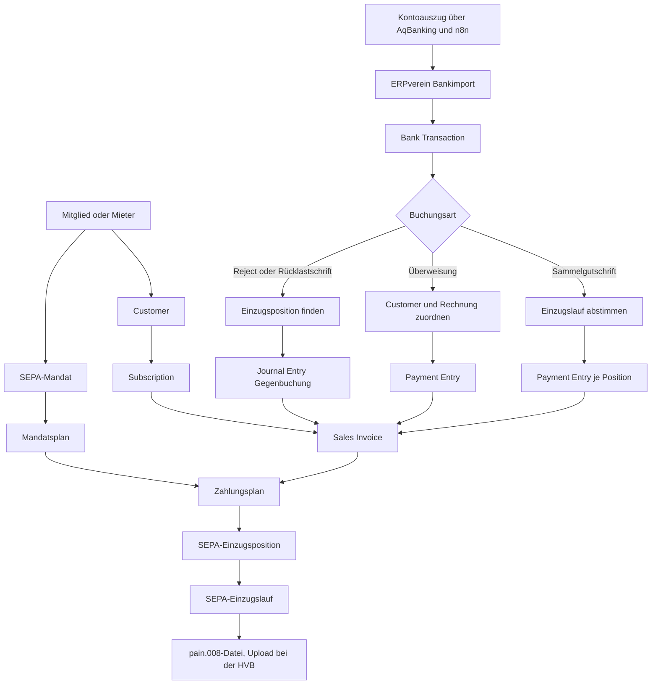
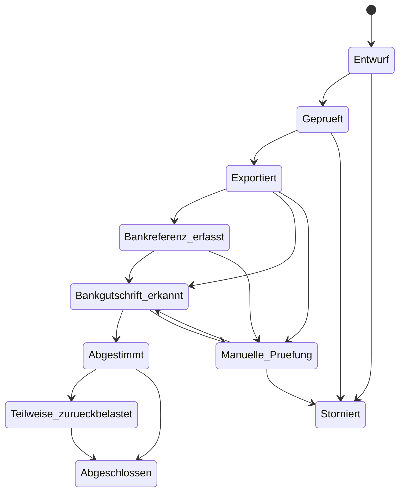
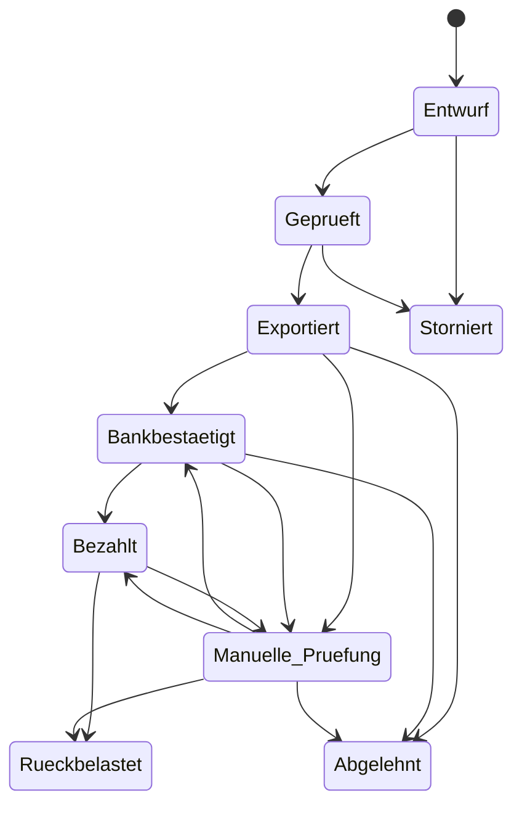

# ERPverein – Fach- und Implementierungsspezifikation

**Dokument:** `spec.md`  
**Status:** Entwurf zur fachlichen Freigabe  
**Version:** 0.4 vom 02.11.2026 – Entscheidungen zu Zahlungsplan, SEPA-Lastschriftlauf und Bankabgleich eingearbeitet (Kapitel 31 und 32); Einzugslauf und pain.008 nach Umsetzung präzisiert (Kapitel 33); Bankimport nach Umsetzung präzisiert (Kapitel 34)  
**Geltungsbereich:** ERPverein auf Frappe `v16.54.0` und ERPNext `v16.53.0`\
**Implementierungsstatus dieses Dokuments:** Nur Spezifikation; keine der hier beschriebenen neuen Funktionen ist durch dieses Dokument implementiert.  
**Datenschutz:** Dieses Dokument enthält ausschließlich abstrahierte oder synthetische Beispiele. Es enthält keine produktiven Namen, Bankverbindungen, Kontonummern, Beträge, Mandatsreferenzen, End-to-End-Referenzen oder Originalbuchungstexte.

---

## 1. Zweck des Dokuments

Dieses Dokument beschreibt den aktuellen Funktionsstand von ERPverein und die geplante Zielarchitektur für:

1. Mitglieds- und Mietabrechnung über ERPNext Subscriptions,
2. automatische Rechnungserzeugung,
3. die transparente Anzeige von Subscriptions, Rechnungen und Zahlungszuordnungen in `Mitglied` und `Mieter`,
4. SEPA-Mandate und Lastschrifteinzüge,
5. den Export von Lastschrift-Sammelaufträgen an die Hausbank,
6. den Import von Kontoauszügen,
7. die robuste Zuordnung realer Kontobewegungen zu Zahlungen und Rechnungen,
8. Selbstüberweiser und Zahlungen über mehrere Rechnungen,
9. Rejects und Rücklastschriften,
10. die historische Rekonstruktion ab dem 1. Januar 2016,
11. Datenschutz, Berechtigungen, Auditierbarkeit und Idempotenz.

Dieses Dokument ist die fachliche und technische Grundlage für spätere Implementierungen. Jede spätere Änderung soll einer Task-ID und einem Abnahmekriterium aus dieser Spezifikation zugeordnet werden können.

---

## 2. Ziele

### 2.1 Primäre Ziele

ERPverein soll einen einfachen, linearen und nachvollziehbaren Forderungs- und Zahlungsprozess abbilden:

```text
Stammdaten
→ Abrechnungsgrundlage
→ Rechnung
→ Einzugsauftrag oder Überweisung
→ Kontoauszug
→ Zahlung
→ Rechnungszuordnung
→ gegebenenfalls Rückbuchung
```

Dabei gelten folgende Ziele:

- ERPNext bleibt die einzige buchhalterische Wahrheit.
- Jede Rechnung, Zahlung, Rückbuchung und Kontobewegung bleibt als echtes ERPNext-Dokument nachvollziehbar.
- Eine Rechnung gilt erst nach einer bestätigten Kontobewegung und einer echten ERPNext-Zahlungszuordnung als bezahlt.
- Fehler sollen dort sichtbar werden, wo sie entstehen.
- Zwischen Rechnungserzeugung, Lastschriftplanung, Bankexport und Zahlungsbestätigung bestehen nur die fachlich notwendigen Abhängigkeiten.
- Mitglieds- und Mietvorgänge bleiben auch bei einem gemeinsamen Customer fachlich unterscheidbar.
- Die Benutzeroberfläche zeigt echte Dokumentketten und keine kopierten Statuswerte.
- Wiederholte Importe und wiederholte Jobs dürfen keine Doppelbuchungen erzeugen.
- Rücklastschriften löschen oder überschreiben keine historischen Zahlungen.
- Produktive Bankdaten gelangen nicht in Git, Dokumentation, Testfixtures oder technische Logs.

### 2.2 Qualitätsziele

Die Lösung soll:

- deterministisch,
- idempotent,
- fehlertolerant,
- auditierbar,
- permission-aware,
- datensparsam,
- modular,
- erweiterbar auf weitere Bankformate,
- und mit ERPNext-Standardmechanismen kompatibel sein.

---

## 3. Nicht-Ziele

Die erste Implementierung soll ausdrücklich nicht:

- eine zweite Buchhaltung neben ERPNext aufbauen,
- eigene offene Rechnungsbeträge speichern,
- Payment Ledger oder General Ledger nachbilden,
- Rechnungs- und Mandatsbeträge automatisch synchronisieren,
- einen Bankexport bereits als Zahlung behandeln,
- unsichere automatische Zuordnungen allein anhand eines Namens oder Betrags buchen,
- Kontoauszüge aus PDF als primäre Datenquelle verarbeiten,
- vollständige Bankdaten in Mitglied oder Mieter duplizieren,
- vorhandene ERPNext-Banking-Funktionen ersetzen,
- Rücklastschriftgebühren automatisch dem Schuldner weiterberechnen,
- mehrere Banken oder Geschäftskonten in der ersten Ausbaustufe automatisieren,
- oder eine Lastschriftdatei automatisch bei der Bank einreichen.

Der SEPA-XML-Export im Format `pain.008.001.08` ist Teil der ersten Ausbaustufe (ADR-013). Der Kassenwart lädt die Datei manuell in PayGate (HVB) hoch. Ein CSV- oder TSV-Export für PayGate entfällt. Weitere Formate lassen sich später über den formatneutralen Kern ergänzen (Kapitel 13.2).

---

## 4. Verbindliche Architekturentscheidungen

### ADR-001 – ERPNext ist das buchhalterische System of Record

Führende ERPNext-Objekte:

| Fachlicher Gegenstand | Führendes Objekt |
|---|---|
| wiederkehrende Abrechnungsgrundlage | `Subscription` |
| Forderung | `Sales Invoice` |
| tatsächliche Zahlung | `Payment Entry` |
| Zuordnung eines Zahlungsbetrags zu Rechnungen | `Payment Entry Reference` und Payment Ledger |
| tatsächliche Kontobewegung | `Bank Transaction` |
| Rückbuchung und Sonderbuchung | `Journal Entry` |
| Bankabstimmung | ERPNext Banking / Bank Reconciliation |
| Geschäftskonto oder Gegenkonto | `Bank Account` |
| Debitor | `Customer` |

ERPverein darf keine parallele Zahlungstabelle als buchhalterische Wahrheit einführen.

### ADR-002 – Gemeinsamer Customer

Eine natürliche oder juristische Person darf gleichzeitig `Mitglied` und `Mieter` sein und dafür denselben ERPNext-`Customer` verwenden.

Die fachlichen Vorgänge bleiben über folgende Herkunftsinformationen getrennt:

- Mitglied oder Mieter,
- Abrechnungsart,
- Subscription-Herkunft,
- Abrechnungslauf,
- SEPA-Mandat,
- Einzugsposition,
- zugehörige Rechnung.

### ADR-003 – Getrennte Mandate

Wenn dieselbe Person Mitglied und Mieter ist, werden Mitgliedsbeitrag und Miete über getrennte SEPA-Mandate und getrennte Einzugsvorgänge geführt. Dies gilt auch dann, wenn Kontoinhaber und IBAN identisch sind.

### ADR-004 – Rechnung und Lastschrift sind getrennte Prozesse

Die Rechnungskette lautet:

```text
Mitglied oder Mieter
→ Customer
→ Subscription
→ Sales Invoice
```

Die Lastschriftkette lautet:

```text
Sales Invoice mit Zahlungsplan
→ Lastschriftzeile (aus dem Mandatsplan des aktiven SEPA-Mandats erzeugt)
→ Einzugsposition
→ Einzugslauf
→ pain.008-Datei
→ Kontoauszug
→ Payment Entry
→ Sales Invoice
```

Eine Subscription erzeugt keine Lastschrift. Ein Mandat erzeugt keine Rechnung. Das Mandat liefert nur Termine und Beträge für die Lastschriftzeilen des Zahlungsplans (ADR-012).

### ADR-005 – Der Lastschriftbetrag kommt aus der Lastschriftzeile des Zahlungsplans

Der Betrag einer Einzugsposition ist der offene Betrag einer Lastschriftzeile im Zahlungsplan der Rechnung. ERPverein erzeugt diese Zeile bei der Rechnung aus dem Mandatsplan. Danach ändert sie nur eine bewusste Bearbeitung des Zahlungsplans (Kapitel 31).

Beispiel:

```text
Rechnung:                            350 EUR
Mandatsplan:                         300 EUR zum 31.03.
Zahlungsplanzeile 1 (Lastschrift):   300 EUR, fällig 31.03.
Zahlungsplanzeile 2 (Überweisung):    50 EUR, Restzeile
bestätigte Lastschrift:              300 EUR
offener Rechnungsbetrag:              50 EUR
```

Ist die Summe des Mandatsplans im Leistungszeitraum größer als der Rechnungsbetrag, entsteht keine Lastschriftzeile. Der Konflikt erscheint im Arbeitsvorrat. Eine automatische Kürzung des Mandatsbetrags ist nicht zulässig.

### ADR-006 – Eine Einzugsposition gehört genau einer Zahlungsplanzeile

```text
Eine SEPA-Einzugsposition → genau eine Zahlungsplanzeile → genau eine Sales Invoice
Eine Zahlungsplanzeile    → höchstens eine aktive SEPA-Einzugsposition
Eine Sales Invoice        → null bis viele SEPA-Einzugspositionen
```

Eine Einzugsposition darf nicht auf mehrere Zahlungsplanzeilen oder Rechnungen aufgeteilt werden.

Eine normale Überweisung darf dagegen mehrere Rechnungen begleichen, sofern die Zahlungsbuchung fachlich und technisch zulässig ist.

### ADR-007 – Zahlungswirkung erst nach Kontoauszug

Ein Bankexport, ein angenommener Bankauftrag oder ein interner Status „übermittelt“ reduziert keinen offenen Rechnungsbetrag.

Erst eine bestätigte `Bank Transaction` und ein eingereichter, zugeordneter `Payment Entry` oder `Journal Entry` verändern den offenen Betrag.

### ADR-008 – Variabler Verwendungszweck und stabile technische Referenz

Der Verwendungszweck ist variabel und menschenlesbar.

Er ist nicht der technische Primärschlüssel.

Jede Einzugsposition erhält zusätzlich eine:

- unveränderliche interne Positions-ID,
- stabile End-to-End-Referenz, sofern der Bankweg sie unterstützt,
- dauerhafte Mandatsreferenz als Mandatsschlüssel.

### ADR-009 – Rücklastschriften sind Gegenbuchungen

Die ursprüngliche Zahlung bleibt erhalten.

Eine Rücklastschrift wird als neue negative `Bank Transaction` und als neue buchhalterische Gegenbuchung erfasst. Die betroffene Rechnung wird dadurch wieder ganz oder teilweise offen.

### ADR-010 – Historische Rekonstruktion ab 2016

Ausgangspunkt ist ein geprüfter Eröffnungssaldo zum Beginn des 1. Januar 2016. Danach werden die Geschäftsvorfälle ab 2016 chronologisch nachgebucht.

Der Eröffnungssaldo darf keine bereits enthaltenen Bewegungen aus 2016 doppelt erfassen.

Die Historie reicht bis zum Tag vor dem Go-live-Stichtag. Sie kommt vor dem Release nach ERPNext (Kapitel 19, Phase H in Kapitel 24).

### ADR-011 – Bankdaten werden datensparsam gespeichert

Originale Kontoauszüge und Bankexporte werden als private Dateien gespeichert.

Sensible Werte werden nicht unnötig in weitere DocTypes kopiert. Wo ein unveränderlicher Nachweis erforderlich ist, werden bevorzugt verwendet:

- Links auf das führende Dokument,
- maskierte Werte,
- kryptografische Hashes,
- private Exportdateien,
- und technisch notwendige Referenzen.

### ADR-012 – Der Zahlungsplan der Rechnung steuert die Lastschrift

Jede Rechnung aus einer ERPverein-Subscription erhält einen Zahlungsplan in der ERPNext-Standardtabelle `payment_schedule`. Hat der Zahler die Abrechnungsart `Lastschrift`, ein aktives Mandat und einen vollständigen Mandatsplan, kommen die Zeilen aus den Einzugsterminen des Mandats. Sonst gilt der ERPNext-Standardplan mit der Zahlungsweise „Überweisung“. Der Zahlungsplan ist bearbeitbar (Kapitel 31).

### ADR-013 – SEPA-XML `pain.008.001.08` und manueller Upload

ERPverein erzeugt je Einzugslauf eine Datei `pain.008.001.08` nach DFÜ-Abkommen Anlage 3 (DK-TVS GBIC_5). Der Kassenwart lädt die Datei herunter, lädt sie in PayGate (HVB Corporate Portal) hoch und gibt sie dort mit TAN frei. ERPverein reicht nichts automatisch ein. Der Export bucht keine Zahlung (ADR-007).

### ADR-014 – Bankumsätze kommen über AqBanking und n8n

Die Banking-Webtop ruft Umsätze mit AqBanking per FinTS ab. n8n übergibt Manifest und Datei unverändert an genau eine ERPverein-API. ERPverein parst die Datei, prüft Duplikate, legt `Bank Transaction` an und gleicht deterministisch ab. n8n enthält keine Buchungslogik.

### ADR-015 – Der Go-live-Stichtag trennt Historie und laufenden Betrieb

Vor dem Go-live-Stichtag zieht Vereinsmeister ein. Diese Vorgänge kommen als Historie nach ERPNext (Kapitel 19). ERPverein erzeugt keine Einzugsposition für eine Fälligkeit vor dem Stichtag. Der laufende Bankimport übernimmt nur Bankumsätze ab dem Stichtag. Ziel-Stichtag ist der 01.01.2027.

---

## 5. Begriffe

### 5.1 Rechnung

Eine eingereichte ERPNext-`Sales Invoice`. Der offene Betrag wird ausschließlich von ERPNext berechnet.

### 5.2 Zahlung

Ein eingereichter ERPNext-`Payment Entry` oder in begründeten Sonderfällen ein `Journal Entry`, der über ERPNext-Referenzen auf eine oder mehrere Rechnungen wirkt.

### 5.3 Bank Transaction

Eine tatsächlich im Kontoauszug vorhandene Kontobewegung. Eine Bank Transaction ist noch keine Rechnung und noch keine Zahlungszuordnung.

### 5.4 SEPA-Mandat

Die Einzugsermächtigung mit Mandatsreferenz, Mandatsdatum, Kontoverbindung, Status und Einzugsplanung.

### 5.5 Einzugslauf

Ein fachlicher Sammelvorgang mit mehreren Einzugspositionen, der als eine oder mehrere Dateien an die Bank übergeben wird.

### 5.6 Einzugsposition

Ein einzelner geplanter Einzug für genau eine Rechnung, genau einen Customer und genau ein aktives Mandat.

### 5.7 Sammelgutschrift

Eine positive Bankbewegung, welche die Summe eines Lastschriftlaufs auf dem Geschäftskonto abbildet.

### 5.8 Reject

Eine nicht erfolgreich ausgeführte Einzugsposition. Ein Reject kann vor oder im unmittelbaren Zusammenhang mit der Sammelgutschrift auftreten.

### 5.9 Rücklastschrift

Eine spätere negative Bankbewegung, durch die ein bereits gutgeschriebener Einzug ganz oder teilweise zurückgegeben wird.

### 5.10 Zahlungszuordnung

Der einer konkreten Rechnung zugeordnete Teilbetrag eines Payment Entry oder Journal Entry.

### 5.11 Zahlungsplan und Zahlungsplanzeile

Der Zahlungsplan ist die ERPNext-Tabelle `payment_schedule` (`Payment Schedule`) einer Rechnung. Eine Zahlungsplanzeile hat Fälligkeit, Betrag, Zahlungsweise (`Mode of Payment`: „SEPA-Lastschrift“ oder „Überweisung“) und eine innerhalb der Rechnung eindeutige Zahlungsbedingung (`Payment Term`). Eine Lastschriftzeile ist eine Zeile mit der Zahlungsweise „SEPA-Lastschrift“.

### 5.12 Mandatsplan

Einzugsintervall, Termine und Beträge im `SEPA Mandat` (Tabelle `SEPA Einzugstermin` oder regelmäßiger Betrag).

### 5.13 Vorabankündigung

Die SEPA-Pre-Notification an den Zahler. Sie ist die Rechnung mit Zahlungsplan, versendet per E-Mail.

### 5.14 Go-live-Stichtag

Der erste Tag, ab dem ERPverein statt Vereinsmeister einzieht und Bankumsätze laufend importiert.

### 5.15 Arbeitsvorrat

Die Liste aller Fälle, die der Kassenwart prüfen muss (Kapitel 22.4).

---

## 6. Aktueller Implementierungsstand

### 6.1 Zielumgebung

Der aktuelle Repository-Stand zielt auf:

- Frappe `v16.54.0`,
- ERPNext `v16.53.0`,
- ERPverein `0.1.12`.

Die App setzt ERPNext als erforderliche App voraus.

### 6.2 Mitglied

`Mitglied` ist ein app-eigener Stammdaten-DocType.

Vorhanden sind unter anderem:

- Personendaten,
- Eintritts- und Austrittsdatum,
- Abrechnungsart,
- Jahresbeitrag,
- Beitragszahler,
- Customer-Link,
- SEPA-Mandat-Link.

`Mitglied` ist selbst kein Buchungsbeleg.

### 6.3 Mieter

`Mieter` ist ein app-eigener Stammdaten-DocType.

Vorhanden sind unter anderem:

- Stammdaten,
- Mietbeginn und Mietende,
- Abrechnungsdaten,
- Customer-Link,
- SEPA-Mandat-Link.

`Mieter` ist selbst kein Buchungsbeleg.

### 6.4 Customer-Synchronisation

Mitglied und Mieter werden serverseitig mit ERPNext-`Customer` verknüpft und synchronisiert.

Bereits implementiert sind:

- Validierung der Beziehungen,
- Synchronisation in beide Richtungen,
- Schutz vor widersprüchlichen Mehrfachverknüpfungen,
- Schutz vor Änderungen bei aktiven Mandaten,
- Buttons zum Synchronisieren und Öffnen des Customers.

Ein Customer darf gleichzeitig ein Mitglied und einen Mieter repräsentieren.

### 6.5 Abrechnungsassistenten

Vorhanden sind getrennte Assistenten für:

- Beitragsabrechnung,
- Mietabrechnung.

Sie erzeugen ERPNext-`Subscription`-Dokumente.

Die Subscriptions tragen bereits Herkunftsinformationen wie:

- Abrechnungsart,
- Generierungsschlüssel,
- Snapshot der Generierungsdaten,
- erzeugender Abrechnungslauf,
- fachliche Quelle und Rolle.

Die Generierung besitzt Wiederholungs- und Konfliktschutz.

### 6.6 Automatische Rechnungen

ERPNext Subscriptions erzeugen Sales Invoices.

Die Sales Invoice besitzt den Standardlink auf die Subscription sowie einen Leistungszeitraum.

### 6.7 SEPA-Mandate

Vorhanden sind:

- Mandatsreferenz,
- Mandatsdatum,
- Status,
- fachlicher Bezug auf Mitglied oder Mieter,
- Customer,
- ERPNext Bank Account,
- IBAN, BIC und Kontoinhaber über die Mandats-/Bankkonto-Logik,
- Einzugsintervall,
- Beginn und Ende des Einzugsplans,
- regelmäßiger Betrag oder einzelne Jahrestermine,
- nächster Solltermin,
- nächster effektiver Einzugstermin,
- Planungsstatus,
- Fingerprint der Einzugsplanung.

Pro Mitglied oder Mieter ist nur ein aktives Mandat zulässig.

### 6.8 Scheduler

Vorhanden sind:

- tägliche Aktualisierung der SEPA-Einzugsplanprojektionen,
- stündliche Bereinigung beziehungsweise Abstimmung veralteter Abrechnungsjobs.

### 6.9 Noch nicht implementiert

Stand 02.11.2026: Umgesetzt sind Zahlungsplan und Vorabankündigung (Phase 1, Kapitel 31), Einzugsläufe, Einzugspositionen und `pain.008.001.08`-Export mit End-to-End-Referenzen (Phase 2, Kapitel 33) sowie der Bankimport der AqBanking-CSV über n8n mit Duplikatschutz (Phase 3, Kapitel 34).

Noch nicht vorhanden sind:

- eingebettete Subscription-, Rechnungs- und Zahlungsansichten in Mitglied und Mieter,
- automatische Zuordnung von Sammelgutschriften,
- Payment-Entry-Erzeugung je Einzugsposition,
- Selbstüberweiser-Matching,
- Reject- und Rücklastschriftprozess,
- historische Übernahme ab 2016.

---

## 7. Zielarchitektur



### 7.1 Trennung der Verantwortlichkeiten

| Schicht | Verantwortung |
|---|---|
| Mitglied/Mieter | fachliche Stammdaten |
| Customer | ERPNext-Debitor |
| Subscription | wiederkehrende Abrechnung |
| Sales Invoice | Forderung |
| SEPA-Mandat | Berechtigung, Bankdaten und Einzugsplan |
| Einzugslauf/-position | operative Bankeinreichung |
| Bank Transaction | reale Kontobewegung |
| Payment Entry | tatsächliche Zahlung |
| Journal Entry | Rückbuchung und Sonderfall |
| Payment Ledger | offene und bezahlte Beträge |
| Read-only-Sichten | Transparenz ohne Datenkopie |

---

## 8. Read-only-Sichten in Mitglied und Mieter

### 8.1 Ziel

Mitarbeitende sollen in `Mitglied` und `Mieter` erkennen können:

- welche Subscriptions existieren,
- welche Rechnungen erzeugt wurden,
- welche Beträge offen sind,
- welche Zahlungen eine Rechnung beglichen haben,
- welche Lastschrifteinzüge geplant oder ausgeführt wurden,
- und ob eine Zahlung später zurückgebucht wurde.

Die Ansichten dürfen keine buchhalterischen Daten kopieren oder editierbar machen.

### 8.2 Subscription-Sicht

Spalten:

- Subscription-ID,
- Status,
- aktiv/inaktiv,
- Startdatum,
- Enddatum,
- Subscription Plan,
- Abrechnungsart,
- fachliche Rolle,
- Abrechnungslauf,
- Customer,
- Link zum Originaldokument.

Filterlogik:

- primär über ERPverein-Subscription-Herkunft,
- nicht ausschließlich über Customer,
- damit Mitglieds- und Mietvorgänge bei gemeinsamem Customer getrennt bleiben.

### 8.3 Rechnungssicht

Spalten:

- Rechnungsnummer,
- Rechnungsdatum,
- Fälligkeit,
- Leistungszeitraum von/bis,
- Gesamtbetrag,
- offener Betrag,
- Status,
- Subscription,
- Abrechnungsart,
- Link zum Originaldokument.

### 8.4 Zahlungszuordnungssicht

Eine Zeile entspricht einer echten Zuordnung zwischen Zahlungsbeleg und Rechnung.

Spalten:

- Rechnung,
- Payment Entry oder Journal Entry,
- Belegstatus,
- Zahlungsdatum,
- Wertstellungsdatum, sofern bekannt,
- Gesamtbetrag des Zahlungsbelegs,
- dieser Rechnung zugeordneter Betrag,
- Bankreferenz,
- Verwendungszweck oder Beschreibung in gekürzter Form,
- Bank Transaction,
- Rückbuchungsstatus,
- Link zu allen Originaldokumenten.

### 8.5 Lastschriftsicht

Spalten:

- Einzugsposition,
- Einzugslauf,
- Mandat,
- Rechnung,
- Einzugsbetrag,
- Einzugsdatum,
- Status,
- Payment Entry,
- Rücklastschriftstatus,
- Link zu den Originaldokumenten.

### 8.6 Technische Umsetzung

- serverseitige, whitelisted und permission-aware APIs,
- keine Abfragen mit pauschaler Berechtigungsumgehung,
- Lazy Loading beim Öffnen des Formulars,
- paginierbare Tabellen,
- direkte Links zu ERPNext-Dokumenten,
- keine editierbaren Child Tables,
- keine dauerhafte Speicherung des offenen Betrags in Mitglied oder Mieter.

### 8.7 Abnahmekriterien

- Ein gemeinsamer Customer zeigt in Mitglied nur die Mitgliedsvorgänge und in Mieter nur die Mietvorgänge.
- Eine Rechnung mit zwei Teilzahlungen zeigt zwei Zahlungszuordnungen.
- Eine Zahlung über mehrere Rechnungen zeigt bei jeder Rechnung nur den jeweils zugeordneten Teilbetrag.
- Eine zurückgebuchte Zahlung bleibt sichtbar und die Rechnung wird wieder als offen angezeigt.
- Benutzer ohne Berechtigung für Accounts-Dokumente erhalten keine sensiblen Details.

### 8.8 Tasks

- `VIEW-001` Subscription-Sicht Mitglied
- `VIEW-002` Subscription-Sicht Mieter
- `VIEW-003` Rechnungssicht
- `VIEW-004` Zahlungszuordnungssicht
- `VIEW-005` Lastschriftsicht
- `VIEW-006` Pagination und Performance
- `VIEW-007` Berechtigungstests

---

## 9. SEPA-Exportprofil

### 9.1 Neuer DocType `SEPA Exportprofil`

Das Exportprofil kapselt bank- und unternehmensbezogene Einstellungen.

Vorgeschlagene Felder:

| Feldname | Typ | Pflicht | Bedeutung |
|---|---|---:|---|
| `profile_name` | Data | ja | sprechender Profilname |
| `company` | Link `Company` | ja | buchende Gesellschaft |
| `bank_account` | Link `Bank Account` | ja | Geschäftskonto |
| `bank` | Link `Bank` | ja | Hausbank |
| `creditor_identifier` | Data | ja | SEPA-Gläubiger-ID |
| `creditor_name` | Data | ja | Name des Gläubigers in der Datei (Kontoinhaber), nach Umwandlung höchstens 70 Zeichen |
| `scheme` | Select | ja | zunächst `CORE`, später optional `B2B` |
| `export_format` | Select | ja | `pain.008.001.08` (DK-TVS GBIC_5) |
| `batch_booking_default` | Check | ja | Standard für `BtchBookg`, Standard `1` (Sammelbuchung) |
| `lead_time_business_days` | Int | ja | Vorlauf in TARGET2-Geschäftstagen, CORE: 1 |
| `earliest_submission_business_days` | Int | ja | Einreichung frühestens so viele TARGET2-Geschäftstage vor dem Einzug, HVB: 15 |
| `prenotification_days` | Int | ja | Frist der Vorabankündigung in Kalendertagen, Standard 14 |
| `rent_prenotification_required` | Check | nein | Vorabankündigung per E-Mail auch für Mieten; Standard aus (Entscheidung E30) |
| `go_live_date` | Date | ja | Go-live-Stichtag; keine Einzugsposition für eine Fälligkeit davor |
| `settlement_tolerance_days` | Int | ja | Toleranz zwischen Einzugsdatum und Buchungsdatum der Sammelgutschrift |
| `max_positions_per_file` | Int | ja | konfigurierbares Dateilimit |
| `default_purpose_template` | Small Text | nein | Standard-Verwendungszweck |
| `default_fee_account` | Link `Account` | ja | Konto für Bank- und Rücklastschriftgebühren (68550) |
| `currency` | Link `Currency` | ja | zunächst `EUR` |
| `active` | Check | ja | Profil aktiv |
| `profile_version` | Data | ja | versioniert Parser/Exporter |
| `notes` | Small Text | nein | interne Hinweise |

### 9.2 Regeln

- Pro Geschäftskonto darf nur ein Profil gleicher Verfahrensart aktiv sein.
- Die Gläubiger-ID wird nicht am einzelnen Mandat dupliziert.
- Die Gläubiger-ID wird nur auf der Site gepflegt, nie in Git, Tests oder Dokumentation.
- Das Dateilimit ist konfigurierbar.
- Änderungen am Profil wirken nicht rückwirkend auf bereits exportierte Läufe.
- Jeder Export speichert die verwendete Profilversion.

### 9.3 Bank-Akzeptanztest

Vor produktivem Einsatz muss geklärt und dokumentiert werden:

- ob PayGate (HVB Corporate Portal) die Datei `pain.008.001.08` annimmt,
- ob PayGate einen Test ohne Ausführung erlaubt (zum Beispiel Upload ohne Freigabe),
- welche Feldlängen und Zeichensätze gelten (DK-TVS GBIC_5),
- welcher Sequenztyp akzeptiert wird (`RCUR` für laufende Mandate; `FRST` für neue Mandate prüfen),
- welcher Annahmeschluss gilt,
- und welche Referenz (`PmtInfId` oder `MsgId`) die HVB bei der Sammelgutschrift als Kundenreferenz zurückgibt.

Ohne erfolgreichen Akzeptanztest darf kein produktiver Export freigegeben werden.

### 9.4 Tasks

- `PROFILE-001` DocType und Validierung
- `PROFILE-002` Gläubiger-ID
- `PROFILE-003` Dateilimit
- `PROFILE-004` Profilversionierung
- `PROFILE-005` Bank-Akzeptanztest

---

## 10. SEPA-Einzugslauf

### 10.1 Neuer DocType `SEPA Einzugslauf`

Ein Einzugslauf repräsentiert eine fachliche Sammlung von Einzugspositionen und ihre Übergabe an die Bank.

### 10.2 Benennung

Vorgeschlagene Naming Series:

```text
SEPA-LAUF-.YYYY.-.#####
```

### 10.3 Felder

| Feldname | Typ | Pflicht | Bedeutung |
|---|---|---:|---|
| `company` | Link `Company` | ja | Gesellschaft |
| `export_profile` | Link `SEPA Exportprofil` | ja | verwendetes Bankprofil |
| `bank_account` | Link `Bank Account` | ja | Geschäftskonto |
| `collection_date` | Date | ja | gewünschtes Einzugs-/Fälligkeitsdatum |
| `sequence_type` | Select | ja | Sequenztyp des Laufs (`RCUR`, `FRST`, `OOFF`) |
| `batch_booking` | Check | ja | `BtchBookg`; `0` bei Einzelbuchung |
| `msg_id` | Data | read-only | `GrpHdr/MsgId` der Datei |
| `pmtinf_id` | Data | read-only | `PmtInf/PmtInfId` = Name des Einzugslaufs |
| `status` | Select | ja | Laufstatus |
| `position_count` | Int | read-only | Anzahl Positionen |
| `total_amount` | Currency | read-only | Summe Positionen |
| `currency` | Link `Currency` | ja | EUR |
| `export_format` | Data/Select | read-only | verwendetes Format |
| `export_profile_version` | Data | read-only | Profilversion |
| `export_file` | Attach | nein | private Exportdatei |
| `export_file_sha256` | Data | nein | Dateihash |
| `exported_at` | Datetime | nein | Exportzeitpunkt |
| `exported_by` | Link `User` | nein | exportierender Benutzer |
| `bank_customer_reference` | Data | nein | bankseitige Kundenreferenz |
| `bank_file_reference` | Data | nein | bankseitige Dateireferenz |
| `bank_order_reference` | Data | nein | bankseitige Auftragsreferenz |
| `settlement_bank_transaction` | Link `Bank Transaction` | nein | Sammelgutschrift |
| `settled_at` | Datetime | nein | Zeitpunkt der Abstimmung |
| `error_count` | Int | read-only | fehlerhafte Positionen |
| `notes` | Small Text | nein | nicht sensible Hinweise |

### 10.4 Statusmodell



Technische Optionswerte werden ASCII-kompatibel gespeichert; die UI darf deutsche Labels anzeigen.

Umsetzung Phase 2: Der Lauf kennt die Status `Entwurf`, `Geprueft`, `Exportiert`, `Bankreferenz erfasst` und `Storniert`. Die übrigen Status kommen mit den Phasen 4 und 6. Ein exportierter Lauf lässt sich nur stornieren, wenn der Benutzer bestätigt, dass die Bank die Datei nicht ausführt (Kapitel 33.6).

### 10.5 Regeln

- Ein Einzugslauf hat genau ein Einzugsdatum und genau einen Sequenztyp. Er erzeugt genau eine Datei mit genau einem `PmtInf`-Block. Bei mehreren Einzugsdaten entstehen mehrere Einzugsläufe.
- Ein exportierter Lauf ist in seinen finanziellen Kerndaten unveränderlich.
- Änderungen nach Export erfordern einen neuen Lauf.
- Die Summe wird ausschließlich aus Positionen berechnet.
- Eine Exportdatei wird privat gespeichert.
- Ein identischer Exporthash darf nicht unbemerkt einem anderen fachlichen Inhalt entsprechen.
- Eine Sammel-Bank-Transaction darf nur einem Einzugslauf zugeordnet sein.
- Eine Abweichung zwischen Bankbetrag und erwarteter Summe führt zu `Manuelle Prüfung`.

### 10.6 Abnahmekriterien

- Ein Lauf kann ohne Positionen nicht geprüft oder exportiert werden.
- Ein exportierter Lauf kann nicht stillschweigend verändert werden.
- Dateihash, Benutzer, Zeitpunkt und Profilversion sind nachvollziehbar.
- Wiederholtes Ausführen der Settlement-Logik erzeugt keine zusätzlichen Zahlungen.

### 10.7 Tasks

- `DD-RUN-001` DocType
- `DD-RUN-002` Statusmaschine
- `DD-RUN-003` Summenberechnung
- `DD-RUN-004` Export-Sperren
- `DD-RUN-005` Bankreferenzen
- `DD-RUN-006` Audit und Berechtigungen

---

## 11. SEPA-Einzugsposition

### 11.1 Neuer DocType `SEPA Einzugsposition`

Die Position ist ein eigenständiger DocType und keine reine Child Table.

Begründung:

- Sie besitzt einen eigenen Lebenszyklus.
- Sie wird einzeln bezahlt, abgelehnt oder zurückgegeben.
- Payment Entry, Bank Transaction und Journal Entry müssen direkt auf sie verweisen können.
- Sie benötigt eine unveränderliche technische Referenz.
- Sie muss unabhängig von der Darstellung eines Laufs auditierbar sein.

### 11.2 Benennung

Vorgeschlagene Naming Series:

```text
SEPA-POS-.YYYY.-.#######
```

### 11.3 Felder

| Feldname | Typ | Pflicht | Bedeutung |
|---|---|---:|---|
| `collection_run` | Link `SEPA Einzugslauf` | ja | übergeordneter Lauf |
| `source_doctype` | Link `DocType` | ja | `Mitglied` oder `Mieter` |
| `source_name` | Dynamic Link | ja | fachliche Quelle |
| `customer` | Link `Customer` | ja | Debitor |
| `sepa_mandate` | Link `SEPA Mandat` | ja | aktives Mandat |
| `sales_invoice` | Link `Sales Invoice` | ja | genau eine Rechnung |
| `payment_schedule_row` | Data | ja | Name der Zahlungsplanzeile (`Payment Schedule`) |
| `payment_term` | Link `Payment Term` | ja | Zahlungsbedingung der Zeile |
| `due_date` | Date | ja | Fälligkeit der Zeile |
| `collection_date` | Date | ja | Ausführungsdatum |
| `amount` | Currency | ja | offener Betrag der Lastschriftzeile bei Erzeugung |
| `currency` | Link `Currency` | ja | EUR |
| `purpose` | Small Text | ja | variabler Verwendungszweck |
| `internal_reference` | Data | ja, unique | interne stabile Referenz |
| `end_to_end_reference` | Data | ja, unique | stabile Bankreferenz |
| `mandate_reference_snapshot` | Data | ja | Mandatsreferenz bei Export |
| `mandate_date_snapshot` | Date | ja | Mandatsdatum bei Export |
| `debtor_iban_hash` | Data | ja | Hash der normalisierten IBAN |
| `debtor_iban_last4` | Data | ja | maskierte Anzeige |
| `sequence_type` | Select | ja | bankseitig validierter Typ |
| `prenotification_status` | Select | ja | Vorabankündigung (Kapitel 11.7) |
| `prenotification_date` | Date | nein | Versand-/Informationsdatum |
| `status` | Select | ja | Positionsstatus |
| `payment_entry` | Link `Payment Entry` | nein | bestätigte Zahlung |
| `settlement_bank_transaction` | Link `Bank Transaction` | nein | Sammelgutschrift |
| `return_bank_transaction` | Link `Bank Transaction` | nein | Reject/Rücklastschrift |
| `return_journal_entry` | Link `Journal Entry` | nein | Gegenbuchung |
| `return_principal_amount` | Currency | nein | zurückgegebener Hauptbetrag |
| `return_fee_amount` | Currency | nein | Bankgebühren |
| `return_reason_code` | Data | nein | normalisierter Grund |
| `return_reason_text` | Small Text | nein | gekürzte, sensible-freie Beschreibung |
| `processing_error` | Small Text | nein | maskierte Fehlermeldung |

### 11.4 Statusmodell



Umsetzung Phase 2: Die Position kennt die Status `Entwurf`, `Geprueft`, `Exportiert` und `Storniert`. Eine Position ist aktiv, solange sie nicht storniert ist (später auch nicht abgelehnt oder zurückbelastet).

### 11.5 Betragsregeln

Vor Erstellung:

- Das Mandat ist aktiv.
- Die fachliche Quelle stimmt mit dem Mandat überein.
- Der Customer stimmt mit Rechnung und Mandat überein.
- Die Rechnung ist eingereicht.
- Die Rechnung besitzt einen positiven offenen Betrag.
- Die Zahlungsplanzeile hat die Zahlungsweise „SEPA-Lastschrift“ und einen offenen Betrag größer 0.
- Die Fälligkeit liegt am oder vor dem Stichtag des Laufs und am oder nach dem Go-live-Stichtag.
- Das Einzugsdatum liegt nicht nach Austritt beziehungsweise Mietende.
- Für die Zeile gibt es keine aktive Einzugsposition.

Der Betrag der Position ist der offene Betrag der Zeile. Er darf den offenen Betrag der Rechnung nicht übersteigen. Ist er größer, entsteht ein Konflikt und keine Position. Eine automatische Kürzung ist nicht zulässig.

### 11.6 Auswahl über Zahlungsplanzeilen

Die Auswahl läuft über Zahlungsplanzeilen. Jede Lastschriftzeile gehört genau einer Rechnung. Eine Suche nach passenden Rechnungen für einen Mandatstermin entfällt.

### 11.7 Vorabankündigung

Die Rechnung mit Zahlungsplan, versendet per E-Mail, ist die Vorabankündigung. Eine Lastschriftzeile ist einzugsbereit, wenn beide Bedingungen erfüllt sind:

- Die letzte versendete E-Mail mit der Rechnung lag nach der letzten Änderung der Zeile.
- Die letzte versendete E-Mail lag mindestens die Frist vor dem Einzugsdatum. Die Frist steht im Exportprofil. Standard sind 14 Kalendertage.

ERPverein erkennt den Versand an der `Communication` zur Rechnung und an der zugehörigen `Email Queue` im Status `Sent` (Kapitel 31.4).

Mögliche Statuswerte:

- `Nicht erforderlich` (keine Lastschriftzeile),
- `Ausstehend`,
- `Versendet`,
- `Erneut senden` (Lastschriftzeile nach dem Versand geändert),
- `Manuell bestätigt` (Zahler ohne E-Mail-Adresse; der Kassenwart bestätigt).

Für Mieten verlangt ERPverein keine Vorabankündigung, solange `rent_prenotification_required` im Exportprofil aus ist (Entscheidung E30). Die Mietrechnung bekommt dann den Status `Nicht erforderlich`. Eine E-Mail vor dem Anlegen des aktiven Exportprofils zählt nicht, weil ihr PDF keine Gläubiger-ID enthält.

### 11.8 Idempotenz

Ein fachlicher Generierungsschlüssel muss mindestens enthalten:

```text
Rechnung
+ Zahlungsbedingung der Zahlungsplanzeile
+ Fälligkeit der Zeile
```

Derselbe Schlüssel darf nur eine aktive Einzugsposition besitzen. Die Datenbank sichert das über das eindeutige Feld `active_key`: Es trägt den Schlüssel, solange die Position aktiv ist, sonst ist es leer.

### 11.9 Tasks

- `DD-ITEM-001` DocType
- `DD-ITEM-002` stabile Referenzen
- `DD-ITEM-003` Rechnungsfinder
- `DD-ITEM-004` Betragsprüfung
- `DD-ITEM-005` Austritt/Mietende
- `DD-ITEM-006` Vorabankündigung
- `DD-ITEM-007` Idempotenz
- `DD-ITEM-008` Statusmaschine
- `DD-ITEM-009` Datenschutzfelder

---

## 12. Erzeugung von Einzugsläufen

### 12.1 Benutzerfluss

```text
1. Stichtag und Exportprofil wählen
2. fällige Lastschriftzeilen ermitteln (Fälligkeit am oder vor dem Stichtag, am oder nach dem Go-live-Stichtag)
3. Einzugsdatum je Zeile bestimmen (nächster TARGET2-Geschäftstag, mindestens heute plus Vorlauf)
4. Vorschau mit erfolgreichen Positionen und Konflikten anzeigen
5. Benutzer bestätigt die Auswahl
6. Lauf und Positionen im Status Entwurf erzeugen
7. Lauf prüfen
8. Export erzeugen
```

### 12.2 Vorschau

Die Vorschau trennt:

- erzeugbare Positionen,
- kein aktives Mandat oder geändertes Mandat,
- Vorabankündigung fehlt oder kommt zu spät,
- Betrag größer als der offene Betrag,
- Datum nach Austritt oder Mietende,
- bereits vorhandene Position.

### 12.3 Keine versteckten Customer-Abhängigkeiten

Eine Position darf nur von fachlich notwendigen Daten abhängen:

- Customer-Link,
- Rechnung,
- Mandat,
- Bank Account,
- Betrag,
- Termin,
- fachliche Quelle.

Nicht relevante Customer-Felder dürfen den Einzug nicht blockieren.

### 12.4 Transaktionsverhalten

- Die Vorschau schreibt nichts.
- Die bestätigte Generierung ist idempotent.
- Konflikte verhindern nicht die Erstellung anderer eindeutiger Positionen.
- Jede ausgelassene Position erhält einen nachvollziehbaren Grund.
- Ein Lauf mit Teilfehlern bleibt im Entwurf und kann geprüft werden.

### 12.5 Tasks

- `DD-GEN-001` Vorschau-API
- `DD-GEN-002` Rechnungsfindung
- `DD-GEN-003` Konfliktmodell
- `DD-GEN-004` idempotente Erstellung
- `DD-GEN-005` UI-Assistent
- `DD-GEN-006` Berechtigungen

---

## 13. pain.008-Export

### 13.1 Erste Ausbaustufe

Unterstützt wird SEPA-XML `pain.008.001.08` nach DFÜ-Abkommen Anlage 3 (DK-TVS GBIC_5). Ein CSV- oder TSV-Format für PayGate entfällt. Jede Datei wird vor dem Speichern gegen das XSD geprüft.

Die fachlichen Positionsdaten umfassen mindestens:

- Zahlungspflichtiger,
- Zahlungspflichtiger IBAN,
- Mandatsreferenz,
- Mandatsdatum,
- Betrag,
- Verwendungszweck.

Gläubigername, Gläubiger-IBAN, BIC und Gläubiger-ID kommen aus dem Exportprofil. `AmdmntInd` ist `false`, solange Gläubiger-ID und Mandatsreferenz unverändert sind. Der Sequenztyp ist `RCUR`. Eine Anschrift des Zahlers ist nur für Konten außerhalb des EWR nötig; wenn angegeben, dann strukturiert oder hybrid.

### 13.2 Formatneutraler Kern

Der Exportservice erhält kanonische Positionsdaten und übergibt sie an einen formatspezifischen Writer:

```text
CollectionExportService
└── Pain008ExportWriter      [pain.008.001.08, erste Ausbaustufe; Bibliothek sepaxml mit fester Version]
```

### 13.3 Verwendungszweck

Der Verwendungszweck:

- kann aus einer Vorlage erzeugt werden,
- kann vor Export pro Position bearbeitet werden,
- ist nach Export unveränderlich,
- enthält keine zwingende technische Identität,
- darf eine kurze technische Referenz zusätzlich enthalten, falls kein strukturiertes End-to-End-Feld übertragen werden kann.

Vorgeschlagene Template-Platzhalter:

```text
{invoice}
{customer}
{source_id}
{period_from}
{period_to}
{collection_date}
{internal_reference}
```

Nicht jeder Platzhalter muss in der Standardvorlage verwendet werden.

### 13.4 End-to-End-Referenz

Anforderungen:

- höchstens 35 Zeichen,
- ASCII-kompatibel,
- eindeutig,
- unveränderlich,
- keine direkt lesbare IBAN oder Personendaten,
- aus einer internen ID plus Prüfsuffix ableitbar,
- niemals wiederverwenden.

Vorschlag: Die `EndToEndId` ist der Name der Einzugsposition. Die `PmtInfId` ist der Name des Einzugslaufs.

Beispiel ausschließlich synthetisch:

```text
EV26A1B2C3D4E5
```

### 13.5 Exportvalidierung

Ein Lauf kann nur exportiert werden, wenn:

- alle Positionen geprüft sind,
- Profileinstellungen vollständig sind,
- Gläubiger-ID vorhanden ist,
- Geschäftskonto vorhanden ist,
- Mandate aktiv sind,
- Rechnungen weiterhin offen sind,
- Beträge weiterhin zulässig sind,
- Vorabankündigungen rechtzeitig versendet oder manuell bestätigt sind,
- Referenzen eindeutig sind,
- alle Positionen dasselbe Profil und kompatible Ausführungsdaten verwenden.

Die Rechnung wird unmittelbar vor Export erneut geprüft. Eine zwischenzeitlich bezahlte Rechnung führt zum Konflikt.

### 13.6 Dateiaufteilung

Ein Einzugslauf erzeugt genau eine Datei (Kapitel 10.5). Überschreitet die Auswahl das konfigurierte Dateilimit, verteilt ERPverein die Positionen bei der Erzeugung auf mehrere Einzugsläufe. Die Vorschau zeigt diese Aufteilung.

### 13.7 Speicherung

- Exportdatei als private `File`,
- SHA-256-Hash,
- Exportzeitpunkt,
- Benutzer,
- Profilversion,
- Anzahl Positionen,
- Summe,
- unveränderliche Dateizuordnung je Position.

### 13.8 Tasks

- `EXP-001` kanonisches Exportmodell
- `EXP-002` pain.008-Writer mit XSD-Prüfung
- `EXP-003` Verwendungszwecktemplates
- `EXP-004` End-to-End-Referenzen
- `EXP-005` Validierung
- `EXP-006` private Speicherung
- `EXP-007` Dateihash
- `EXP-008` Aufteilung auf mehrere Einzugsläufe
- `EXP-009` synthetische Akzeptanzdatei
- `EXP-010` Upload-Test bei der HVB

---

## 14. Kontoauszugsimport

### 14.1 Grundsatz

Kontoauszüge werden als maschinenlesbarer Export importiert.

Die laufende Quelle ist die AqBanking-CSV (`aqbanking-cli listtrans`) mit einem Manifest. Die Banking-Webtop sendet beides an einen n8n-Webhook. n8n ruft genau eine ERPverein-Methode auf und übergibt Manifest und Datei unverändert. n8n parst keine Zeilen und läuft nicht in einer Schleife pro Umsatz. Der Parser ist versioniert:

- `aqbanking-listtrans-default-v2`: Standardvorlage von AqBanking, tabulatorgetrennt, ohne Kopfzeile,
- `aqbanking-listtrans-template-v3`: erweiterte Vorlage mit Kopfzeile und SEPA-Feldern. ERPverein liest sie seit Phase 3; die Umstellung der Banking-Webtop wartet auf die Freigabe des Benutzers (O7, Kapitel 34.8).

Der laufende Import übernimmt nur Bankumsätze ab dem Go-live-Stichtag.

Der für die Historie untersuchte Bankexport enthält abstrahiert:

- Kontoidentifikation,
- Buchungsdatum,
- Wertstellung,
- ausführlichen Text,
- standardisierten Buchungstext,
- Kundenreferenz,
- Partnerbank,
- Partnerkonto beziehungsweise Partner-IBAN,
- Partnername,
- Betrag,
- SEPA-Gläubiger-ID,
- SEPA-End-to-End-Referenz,
- SEPA-Mandatsreferenz,
- Primanota,
- Textschlüssel,
- Änderungszeitpunkt,
- zusätzliche teilweise unbenannte Rohfelder.

Keine produktiven Beispielwerte werden in Code, Tests oder Dokumentation übernommen.

> **Hinweis:** Die oben genannten Felder stammen aus dem Bankexport für die Historie. Der laufende Import nutzt die AqBanking-CSV. Welche Felder die HVB dort füllt, klärt ein echter Abruf; dem Benutzer werden nur Feldnamen und Füllgrad gezeigt (Kapitel 32). Der Importer bleibt profil- und versionsbasiert und ist nicht fest an eine Quellstruktur gekoppelt.

### 14.2 Technische Besonderheiten

Das Importprofil muss unterstützen:

- Tabulator als mögliches Trennzeichen,
- deutsche Dezimalkommas,
- deutsche Datumsformate,
- Datum/Uhrzeit,
- leere oder nur technisch befüllte Felder,
- geschützte Leerzeichen,
- mehrfach vorkommende Inhalte,
- teilweise unbenannte Spalten,
- Transliterationen wie `Ue` oder `Rueck`,
- positive und negative Beträge in derselben Spalte.

### 14.3 Neuer DocType `ERPverein Bankimport`

Ein app-eigener Importlauf dient als sichere Vorverarbeitung und Audit-Hülle. Das Ergebnis bleiben Standard-`Bank Transaction`-Dokumente.

Felder:

| Feldname | Typ | Bedeutung |
|---|---|---|
| `company` | Link `Company` | Gesellschaft |
| `bank_account` | Link `Bank Account` | Geschäftskonto |
| `import_profile` | Select/Data | Importprofil, zum Beispiel `aqbanking-listtrans-default-v2` |
| `source_file` | Attach | private Originaldatei |
| `source_file_sha256` | Data unique | Dateihash |
| `request_id` | Data | Anfrage-ID aus dem Manifest |
| `idempotency_key` | Data unique | Idempotenzschlüssel aus dem Manifest |
| `status` | Select | Entwurf, Validiert, Importiert, Teilfehler, Fehler |
| `row_count` | Int | Zahl Datenzeilen |
| `new_transaction_count` | Int | neu erzeugte Bewegungen |
| `duplicate_count` | Int | erkannte Duplikate |
| `error_count` | Int | fehlerhafte Zeilen |
| `deposit_total` | Currency | Summe Gutschriften |
| `withdrawal_total` | Currency | Summe Belastungen |
| `started_at` | Datetime | Start |
| `completed_at` | Datetime | Ende |
| `parser_version` | Data | Parser-Version |
| `error_report` | Attach | private, bereinigte Fehlerdatei |

> **Umsetzung (Phase 3):** Status `Entwurf`, `Importiert`, `Teilfehler`, `Fehler`; einen beobachtbaren Status `Validiert` gibt es nicht, weil Prüfung und Import in einem Aufruf laufen. Statt `error_report` hält die Kindtabelle `import_errors` (`ERPverein Bankimport Fehler`: Zeile, Fehlercode, maskierte Meldung) die Fehler; dazu `error_message` für Fehler der ganzen Datei. Weitere Felder: `account_alias`, `manifest_created_at`, `period_from`, `period_to`, `overlap_days`, `go_live_date`, `before_go_live_count`, `zero_amount_count`, `reconciled_count`, `unreconciled_count`, `source_encoding`, `column_fill`, `manifest_json`, `notes`. Einzelheiten in Kapitel 34.

### 14.4 Kanonisches Importmodell

Jede Quellzeile wird zunächst in ein internes Modell normalisiert:

```text
source_row_number
booking_date
value_date
signed_amount
transaction_type
description
reference_number
party_name
party_iban
party_bank_code
sepa_creditor_identifier
sepa_end_to_end_reference
sepa_mandate_reference
primanota
text_key
source_modified_at
source_fingerprint
```

### 14.5 Custom Fields auf `Bank Transaction`

Codeverwaltete Custom Fields:

| Feldname | Typ |
|---|---|
| `erpverein_value_date` | Date |
| `erpverein_sepa_creditor_identifier` | Data |
| `erpverein_sepa_end_to_end_reference` | Data |
| `erpverein_sepa_mandate_reference` | Data |
| `erpverein_primanota` | Data |
| `erpverein_text_key` | Data |
| `erpverein_import_batch` | Link `ERPverein Bankimport` |
| `erpverein_source_row_number` | Int |
| `erpverein_source_fingerprint` | Data, unique |
| `erpverein_source_modified_at` | Datetime |
| `erpverein_bank_category` | Select/Data |
| `erpverein_match_status` | Select |

Der Originaltext bleibt im Standardfeld `description` oder in der privaten Quelldatei. Er wird nicht zusätzlich in Logs dupliziert.

> **Umsetzung (Phase 3):** Zusätzlich `erpverein_customer_reference` (Kundenreferenz). `erpverein_source_modified_at` entfällt, weil AqBanking keinen Änderungszeitpunkt liefert. `erpverein_bank_category` und `erpverein_match_status` sind Select-Felder mit `allow_on_submit`. Am `Bank Account` kommt `erpverein_bank_import_alias` hinzu (Kapitel 34.3).

### 14.6 Klassifikation

Erste Kategorien:

- `Incoming Transfer`,
- `Incoming Standing Order`,
- `Incoming Instant Transfer`,
- `Outgoing Transfer`,
- `Outgoing Standing Order`,
- `Outgoing Direct Debit`,
- `Direct Debit Batch Credit`,
- `Direct Debit Reject`,
- `Direct Debit Return`,
- `Bank Fee`,
- `Other`,
- `Manual Review`.

Die Klassifikation nutzt gemeinsam:

- Vorzeichen,
- standardisierten Buchungstext,
- Textschlüssel,
- SEPA-Felder,
- Beschreibung.

> **Umsetzung (Phase 3):** Die Werte heißen deutsch: `Ueberweisung eingehend`, `Dauerauftrag eingehend`, `Echtzeitueberweisung eingehend`, `Ueberweisung ausgehend`, `Dauerauftrag ausgehend`, `Lastschrift ausgehend`, `Lastschrift-Gutschrift` (Sammel- oder Einzelgutschrift eigener Lastschriften), `Lastschrift-Rueckgabe (Reject)`, `Ruecklastschrift`, `Bankgebuehr`, `Sonstiges`, `Manuelle Pruefung`. Regeln in Kapitel 34.6. Die Kategorie ist ein Hinweis; sie bucht nichts.

### 14.7 Duplikatschutz

#### Dateiebene

```text
SHA-256 der Originaldatei
```

Ein bereits vollständig importierter Dateihash darf nicht erneut importiert werden.

#### Zeilenebene

Der Fingerprint wird aus normalisierten, stabilen Feldern gebildet, beispielsweise:

```text
Bankkonto
+ Buchungsdatum
+ Wertstellung
+ vorzeichenbehafteter Betrag
+ Primanota
+ Textschlüssel
+ Kundenreferenz
+ End-to-End-Referenz
+ Mandatsreferenz
+ Partner-IBAN
+ normalisierter Buchungstext
```

Der Änderungszeitpunkt ist nicht Teil der Identität.

> **Umsetzung (Phase 3):** Der Fingerprint nutzt nur Felder, die beide Profile liefern: Konto-IBAN, Buchungsdatum, vorzeichenbehafteter Betrag, IBAN und Name der Gegenseite, Verwendungszweck (normalisiert, ohne Groß- und Kleinschreibung) und die laufende Nummer gleicher Zeilen in der Datei. So erkennt ERPverein auch beim Wechsel von `v2` auf `v3` dieselben Umsätze. Gleiche Umsätze am selben Tag bleiben getrennt (Kapitel 34.4).

#### Wiederholungsimport

Ein Wiederholungsimport muss:

- null neue Bank Transactions erzeugen,
- null neue Payments erzeugen,
- keine vorhandene Buchhaltung verändern,
- die Duplikate nachvollziehbar zählen.

### 14.8 Fehlerbehandlung

- Fehlerhafte Zeilen verhindern nicht zwingend den Import valider Zeilen.
- Ein Teilimport erhält den Status `Teilfehler`.
- Fehlermeldungen maskieren IBAN und Referenzen.
- Originalzeilen erscheinen nicht im allgemeinen Error Log.
- Die private Fehlerdatei enthält nur die technisch erforderlichen Informationen und ist rollenbeschränkt.

### 14.9 ERPNext Banking

Aufgabenteilung zwischen ERPverein und dem Banking-Bereich `/banking` von ERPNext v16:

| Aufgabe | Wer erledigt sie |
|---|---|
| Bankumsatz anlegen und buchen | ERPverein-Bankimport |
| Partei über IBAN erkennen | ERPNext (`enable_party_matching`) |
| Gebühren und feste Vorgänge buchen | ERPNext-Regeln (`Bank Transaction Rule`) |
| Sammelgutschrift zuordnen und Zahlungen buchen | ERPverein (deterministisch) |
| Selbstzahler mit sicherem Signal | ERPverein (deterministisch) |
| Rücklastschrift mit Gegenbuchung | ERPverein (deterministisch) |
| Unklare Fälle, Teilzahlungen, Umbuchungen | Kassenwart im Banking-Bereich `/banking` |
| Abgleich speichern | ERPNext (`Bank Transaction Payments`) |

ERPverein ersetzt diese Oberfläche nicht. ERPverein verwendet `auto_reconcile_vouchers` nicht für SEPA-Zahlungen, weil diese Funktion alle Kandidaten in Rangfolge verteilt.

Diese Tabellen müssen befüllt sein:

1. `Bank` (HVB) und `Bank Account` für das Vereinskonto mit `is_company_account = 1` und Hauptbuchkonto 18000,
2. `Bank Transaction` je Kontoauszugszeile, gebucht,
3. `Bank Account` je Zahler mit Partei (für Mandate legt ERPverein diese Konten an),
4. `Bank Transaction Rule` für Gebühren und feste Vorgänge (Einrichtung durch den Kassenwart),
5. `Mode of Payment` und `Payment Term` für den Zahlungsplan (Stammdaten durch ERPverein).

### 14.10 Tasks

- `BANK-001` Import-DocType
- `BANK-002` Parser
- `BANK-003` Normalisierung
- `BANK-004` Custom Fields
- `BANK-005` Klassifikation
- `BANK-006` Dateihash
- `BANK-007` Zeilenfingerprint
- `BANK-008` idempotenter Import
- `BANK-009` sichere Fehlerberichte
- `BANK-010` ERPNext-Banking-Integration

---

## 15. Sammellastschrift und Zahlungsbestätigung

### 15.1 Beobachtetes Bankmodell

Ein eigener Lastschriftlauf erscheint auf dem Geschäftskonto als positive Sammelgutschrift.

Die Sammelgutschrift enthält abstrahiert:

- Gesamtbetrag,
- Buchungs- und Wertstellungsdatum,
- eine Referenz auf Lauf oder Datei,
- gegebenenfalls die Zahl der Positionen,
- jedoch keine einzelnen Debitoren- oder Mandatsdaten.

### 15.2 Laufmatching

Matching-Priorität:

1. eindeutige bankseitige Auftrags-/Datei-/Kundenreferenz,
2. Geschäftskonto,
3. Gesamtbetrag,
4. Buchungs- und Wertstellungsdatum,
5. erwartetes Einzugsdatum,
6. Positionsanzahl aus der Beschreibung,
7. manuelle Bestätigung.

Eine automatische Zuordnung erfolgt nur bei genau einem eindeutigen Treffer.

### 15.3 Betragsprüfung

```text
Bankbetrag = erwartete Laufsumme
→ automatische Fortsetzung möglich

Bankbetrag != erwartete Laufsumme
→ keine automatische Zahlungserzeugung
→ Manuelle Prüfung
```

Es erfolgt keine automatische proportionale Kürzung.

### 15.4 Payment Entry je Einzugsposition

Für jede bestätigte Position wird ein eigener `Payment Entry` erzeugt:

- `payment_type = Receive`,
- `party_type = Customer`,
- `party = Position.customer`,
- Bankkonto aus Exportprofil,
- Buchungsdatum aus Bank Transaction,
- `reference_no` = `EndToEndId`, `reference_date` = Buchungsdatum,
- Referenz auf genau eine Sales Invoice mit der Zahlungsbedingung der Zahlungsplanzeile (`payment_term`),
- `allocated_amount = Position.amount`,
- Link auf die Einzugsposition über ein Custom Field.

Alle Payment Entries werden mit derselben Sammel-Bank-Transaction abgestimmt.

### 15.5 Custom Field auf `Payment Entry`

| Feldname | Typ | Bedeutung |
|---|---|---|
| `erpverein_sepa_collection_item` | Link `SEPA Einzugsposition` | eindeutiger Ursprung |
| `erpverein_bank_transaction` | Link `Bank Transaction` | optionale direkte Navigation |

`erpverein_sepa_collection_item` muss für eingereichte Einzugszahlungen eindeutig sein.

### 15.6 Verarbeitung

```text
1. Sammel-Bank-Transaction importieren
2. eindeutigen Einzugslauf finden
3. Lauf auf Bankgutschrift erkannt setzen
4. je Position Payment Entry idempotent erzeugen
5. Payment Entry einreichen
6. Payment Entry auf Rechnung allokieren
7. alle Payments mit Bank Transaction abstimmen
8. Lauf und Positionen aktualisieren
```

### 15.7 Teilfehler

Wenn eine einzelne Payment Entry nicht erzeugt werden kann:

- andere bereits erfolgreiche Positionen bleiben erhalten,
- die Position erhält einen maskierten Fehler,
- der Lauf wird nicht als vollständig abgestimmt markiert,
- ein Wiederholungsjob verarbeitet nur fehlende Positionen,
- bereits vorhandene Payment Entries werden über den Positionslink erkannt.

### 15.8 Abnahmekriterien

- Rechnung 350, Einzug 300: 50 bleiben offen.
- Zwei Einzüge à 150: eine Rechnung über 300 wird vollständig bezahlt.
- Wiederholter Settlement-Job erzeugt keine doppelte Payment Entry.
- Die Summe der zugeordneten Payment Entries entspricht der Bank Transaction.
- Jede Payment Entry verweist auf genau eine Einzugsposition.
- Eine Position verweist auf genau eine Rechnung.

### 15.9 Tasks

- `SETTLE-001` Laufmatcher
- `SETTLE-002` Summenprüfung
- `SETTLE-003` Payment-Entry-Erzeugung
- `SETTLE-004` Rechnungsallokation
- `SETTLE-005` Bank-Reconciliation
- `SETTLE-006` Wiederanlauf
- `SETTLE-007` Teilfehler
- `SETTLE-008` Audit

---

## 16. Selbstüberweiser

### 16.1 Ziel

Normale Überweisungen, Daueraufträge und Echtzeitüberweisungen werden nach dem Kontoauszugsimport einer oder mehreren Rechnungen zugeordnet.

### 16.2 Matching-Signale

Priorität:

1. explizite und eindeutige Rechnungsnummer,
2. eindeutige interne Mitglieds-, Mieter- oder Customer-Referenz,
3. bekannte Partner-IBAN,
4. Name der Gegenpartei,
5. Betrag und Kombination offener Rechnungen,
6. manuelle Auswahl.

Name und Betrag allein dürfen keine automatische Buchung auslösen.

### 16.3 Party-Erkennung

- Bekannte Partner-IBANs werden über ERPNext `Bank Account` und dessen Party-Bezug ermittelt.
- Eine Rechnungsnummer hat Vorrang vor der IBAN.
- Zahlt eine dritte Person eine eindeutig bezeichnete Rechnung, bleibt der Customer der Rechnung die Party des Payment Entry.
- Die tatsächliche Gegenpartei bleibt in der Bank Transaction sichtbar.

### 16.4 Eine Zahlung für mehrere Rechnungen desselben Customers

Eine `Payment Entry` enthält mehrere `Payment Entry Reference`-Zeilen.

Beispiel:

```text
Payment Entry 500 EUR
├── Rechnung A: 300 EUR
└── Rechnung B: 200 EUR
```

### 16.5 Eine Bankbewegung für mehrere Customers

Da eine Payment Entry nur eine Party besitzt, werden mehrere Payment Entries erzeugt und gemeinsam mit derselben Bank Transaction abgestimmt.

Dies entspricht dem Muster der Sammellastschrift.

### 16.6 Teilzahlung

Eine Zahlung unterhalb des Rechnungsrests wird als Teilbetrag allokiert.

### 16.7 Überzahlung

Wenn der Betrag den ausgewählten Rechnungsrest übersteigt:

- der überschüssige Betrag bleibt unallocated oder wird als Customer Advance behandelt,
- keine automatische Abschreibung,
- klare Anzeige zur manuellen Prüfung.

### 16.8 Unbekannte Zahlung

Nicht eindeutig zuordenbare Bank Transactions bleiben `Unreconciled` beziehungsweise `Manual Review`.

Das System zeigt Vorschläge mit Begründung und Konfidenz, bucht aber nicht automatisch.

### 16.9 Zuordnungsvorschlag

Ein Vorschlag enthält:

- vorgeschlagener Customer,
- vorgeschlagene Rechnungen,
- vorgeschlagene Teilbeträge,
- verwendete Matching-Signale,
- Konflikte,
- erforderliche Benutzerbestätigung.

### 16.10 Tasks

- `TRANSFER-001` Rechnungsnummernparser
- `TRANSFER-002` IBAN-Party-Matcher
- `TRANSFER-003` Vorschlagslogik
- `TRANSFER-004` Mehrrechnungszahlung
- `TRANSFER-005` Mehr-Customer-Zahlung
- `TRANSFER-006` Teilzahlung
- `TRANSFER-007` Überzahlung
- `TRANSFER-008` manuelle Bestätigung
- `TRANSFER-009` Audit

---

## 17. Rejects und Rücklastschriften

### 17.1 Erkennbare Informationen

Der Kontoauszug stellt für Rejects und Rücklastschriften abstrahiert häufig bereit:

- negative Kontobewegung,
- Partnername,
- Partner-IBAN,
- End-to-End-Referenz,
- Mandatsreferenz,
- Rückgabegrund,
- Gesamtbetrag,
- gegebenenfalls Gebühreninformationen.

### 17.2 Matching-Priorität

```text
1. End-to-End-Referenz
2. Mandatsreferenz
3. Hash der Partner-IBAN
4. ursprünglicher Einzugsbetrag
5. zeitliche Nähe zum Einzugslauf
6. manuelle Prüfung
```

Ein Name allein ist kein ausreichendes Matching-Signal.

### 17.3 Reject vor Zahlungserzeugung

Wenn die Einzugsposition noch keine Payment Entry besitzt:

- Position auf `Abgelehnt`,
- keine Payment Entry erzeugen, sofern die Bankgutschrift den Betrag nicht enthalten hat,
- eventuelle Gebühren separat buchen,
- Lauf auf Teilfehler oder teilweise zurückbelastet setzen.

Wenn die Sammelgutschrift den Betrag zunächst enthalten hat, wird der Vorgang wie eine Rücklastschrift behandelt.

### 17.4 Rücklastschrift nach bestätigter Zahlung

Ablauf:

```text
1. negative Bank Transaction importieren
2. Einzugsposition eindeutig finden
3. Hauptbetrag und Gebühren bestimmen
4. Journal Entry erzeugen
5. Journal Entry auf ursprüngliche Sales Invoice referenzieren
6. Journal Entry mit negativer Bank Transaction abstimmen
7. Rechnung wird wieder ganz oder teilweise offen
8. Zahlungsplanzeile wieder öffnen (Kapitel 31.6)
9. Position auf Rückbelastet setzen
10. ursprüngliche Payment Entry bleibt bestehen
```

### 17.5 Buchung ohne Gebühren

```text
Soll  Debitor / Customer     Hauptbetrag
Haben Bank                  Hauptbetrag
```

Die Debitorenzeile verweist auf dieselbe Sales Invoice.

### 17.6 Buchung mit Gebühren

```text
Soll  Debitor / Customer     Hauptbetrag
Soll  Bankgebühren          Gebühren
Haben Bank                  Gesamtbelastung
```

### 17.7 Gebührenbestimmung

Priorität:

1. Hauptbetrag aus der Einzugsposition,
2. Gesamtbelastung aus Bank Transaction,
3. Gebühren = Gesamtbelastung minus Hauptbetrag,
4. optionale Unterteilung aus dem Banktext,
5. manuelle Bestätigung bei Widerspruch.

Die automatische Textanalyse darf keine Buchung auslösen, wenn:

- Gesamtbetrag kleiner als Hauptbetrag ist,
- Gebühren nicht plausibel sind,
- mehrere Positionen passen,
- oder die Summe nicht aufgeht.

### 17.8 Custom Fields auf `Journal Entry`

| Feldname | Typ |
|---|---|
| `erpverein_sepa_collection_item` | Link `SEPA Einzugsposition` |
| `erpverein_return_bank_transaction` | Link `Bank Transaction` |
| `erpverein_return_principal_amount` | Currency |
| `erpverein_return_fee_amount` | Currency |
| `erpverein_return_reason_code` | Data |

### 17.9 Keine Verwendung von `Unreconcile Payment` für echte Rücklastschriften

`Unreconcile Payment` ist nur für eine falsche Zuordnung geeignet.

Eine reale Rücklastschrift ist eine neue Bankbewegung und benötigt eine echte Gegenbuchung.

### 17.10 Spätere Gebührenweiterberechnung

Die Weiterberechnung einer Rücklastschriftgebühr an Mitglied oder Mieter ist nicht Teil des Kernprozesses.

Eine spätere Erweiterung darf dafür eine separate Rechnung erzeugen. Sie darf die Gegenbuchung der Rücklastschrift nicht blockieren.

### 17.11 Abnahmekriterien

- Ursprüngliche Payment Entry bleibt eingereicht und sichtbar.
- Negative Bank Transaction ist vollständig abgestimmt.
- Rechnung wird um den Hauptbetrag wieder offen.
- Gebühren verändern nicht den Rechnungsrest der ursprünglichen Rechnung.
- Wiederholte Verarbeitung erzeugt kein zweites Journal Entry.
- Mehrdeutige Rückgaben bleiben in manueller Prüfung.

### 17.12 Tasks

- `RETURN-001` Klassifikation
- `RETURN-002` Positionsmatcher
- `RETURN-003` Reject-Flow
- `RETURN-004` Gebührenbestimmung
- `RETURN-005` Journal Entry
- `RETURN-006` Rechnungsreferenz
- `RETURN-007` Bank-Reconciliation
- `RETURN-008` Idempotenz
- `RETURN-009` manuelle Prüfung
- `RETURN-010` Read-only-Anzeige

---

## 18. Allgemeine Bankregeln

ERPNext-Bankregeln werden für wiederkehrende allgemeine Vorgänge eingesetzt, beispielsweise:

- Bankgebühren,
- Zinsen,
- bekannte Dienstleister,
- feste Gegenkonten,
- interne Umbuchungen.

Sie werden nicht als primärer Matcher für dynamische Mitglieds- oder Mietzahlungen verwendet, weil:

- Partei und Rechnung je Vorgang variieren,
- eine Einzugsposition dynamisch identifiziert werden muss,
- ein Betrag allein nicht eindeutig ist,
- und die fachliche Provenienz berücksichtigt werden muss.

ERPverein-spezifische Matcher liefern Vorschläge oder deterministische Zuordnungen. Die eigentliche Buchung verwendet ERPNext-Standardbelege. Die Aufgabenteilung mit dem Banking-Bereich `/banking` steht in Kapitel 14.9.

---

## 19. Historische Rekonstruktion ab 2016

### 19.1 Ausgangspunkt

Die Historie vom 01.01.2016 bis zum Tag vor dem Go-live-Stichtag kommt vor dem Release nach ERPNext (Phase H). Umfang ist die vollständige Buchhaltung: Rechnungen, Zahlungen, Buchungssätze und jede Bankbewegung, auch jede Ausgabe. Quellen sind Kontoauszüge, Buchhaltung, Mitgliederkonten und das Rechnungsbuch aus Vereinsmeister. Das Rechnungsbuch lässt sich nicht gesamt exportieren. Phase H klärt den Weg: angepasster Bericht oder direkter Zugriff auf die Vereinsmeister-Datenbank. Die alten Vereinsmeister-Konten werden auf SKR 42 übergeleitet. Der Benutzer testet die Historie auf der Entwicklungs-Site und nimmt jedes Jahr ab.

Voraussetzung:

- geprüfter Eröffnungssaldo zum Beginn des 1. Januar 2016,
- keine bereits enthaltenen Geschäftsvorfälle ab dem 1. Januar 2016,
- vollständige maschinenlesbare Kontoauszüge ab 2016,
- rekonstruierbare Rechnungsgrundlagen.

### 19.2 Umfang

Der Bankimport übernimmt alle Kontobewegungen.

Die automatische Forderungszuordnung dieses Projekts konzentriert sich auf:

- Mitglieder,
- Mieter,
- Mitgliedsbeiträge,
- Mieten,
- Zahlungseingänge,
- Lastschriften,
- Rejects,
- Rücklastschriften,
- Bankgebühren im Zusammenhang mit Rückgaben.

Andere Finanzbuchhaltungsbewegungen werden über ERPNext-Standardfunktionen, Bankregeln, Purchase Invoices oder Journal Entries bearbeitet.

### 19.3 Historische Rechnungen

Historische Rechnungen ab 2016 werden als echte Sales Invoices rekonstruiert.

Sie werden nicht durch rückwirkend laufende Subscriptions automatisch erzeugt.

Begründung:

- historische Beträge müssen kontrollierbar sein,
- rückwirkende Subscription-Jobs dürfen keine unbeabsichtigten Rechnungen erzeugen,
- die Migration benötigt einen stabilen, wiederanlaufbaren Prozess.

Historische Rechnungen sind Soll-Rechnungen. Nicht bezahlte Beiträge und Mieten sind Schulden und bleiben als offene Posten sichtbar. Sie kommen nie automatisch in einen Einzugslauf und nie automatisch in eine Mahnung. Wie der Verein mit alten Rückständen umgeht, entscheidet der Benutzer.

Historische Rechnungen erhalten:

- tatsächliches Rechnungsdatum,
- tatsächliche Fälligkeit,
- tatsächlichen Leistungszeitraum,
- Customer,
- fachliche Quelle,
- Herkunft (Quelle, Fingerprint, Jahr),
- synthetischen oder bekannten Quellschlüssel,
- Status und Beträge.

### 19.4 Custom Fields für Migration

Auf relevanten Belegen:

Auf `Sales Invoice`, `Payment Entry`, `Journal Entry` und `Bank Transaction`:

| Feldname | Typ |
|---|---|
| `erpverein_legacy_source_type` | Data |
| `erpverein_legacy_source_id` | Data |
| `erpverein_migration_fingerprint` | Data unique, soweit fachlich möglich |
| `erpverein_legacy_year` | Int |

### 19.5 Aufbereitung und Import

Es gibt keinen DocType `ERPverein Migration Batch`. Der Agent bereitet die Vereinsmeister-Exporte mit Skripten außerhalb des Repositorys auf. Die Skripte ordnen Kontoauszug, Buchhaltung und Mitgliederkonten einander zu. Sie erzeugen Prüflisten und je Jahr eine Importmappe. Der Kassenwart prüft die Zuordnungen. Der Benutzer importiert die Mappe mit n8n über `frappe.client.insert_many`; die Belege werden direkt gebucht (`docstatus = 1`). Fingerprints verhindern doppelte Belege bei einem Wiederholungslauf. Für die Historie gibt es keine Subscriptions.

### 19.6 Reihenfolge pro Jahr

```text
1. Stammdaten prüfen und bereinigen
2. Customer-Verknüpfungen herstellen
3. historische Mandate und Zeiträume erfassen
4. historische Rechnungen erzeugen
5. Rechnungen fachlich prüfen
6. Rechnungen einreichen
7. Bankauszüge importieren
8. Zahlungseingänge zuordnen
9. Lastschriften und Rücklastschriften nachbilden
10. nicht zugeordnete Bankbewegungen bearbeiten
11. Bankkonto abstimmen
12. Debitorensaldo und offene Posten prüfen
13. Jahresabschluss dokumentieren
14. Zeitraum sperren
```

### 19.7 Kontrollsummen

Pro Importperiode:

- Anfangssaldo Bank,
- Summe Gutschriften,
- Summe Belastungen,
- Endsaldo Bank,
- Anzahl Bank Transactions,
- Summe abgestimmter Bank Transactions,
- Summe nicht abgestimmter Bank Transactions,
- Debitorensaldo,
- offene Rechnungen,
- nicht zugeordnete Customer-Zahlungen,
- Anzahl und Summe Rücklastschriften,
- Gebühren.

### 19.8 Idempotenz

- Datei-Hash,
- Zeilenfingerprint,
- fachlicher Belegfingerprint,
- Herkunftsfelder (Quelle, Jahr),
- eindeutige Quell-ID,
- Wiederanlauf ohne Doppelbelege.

### 19.9 Perioden

Ein Zeitraum wird erst gesperrt, wenn:

- Bankendstand stimmt,
- offene Posten geprüft sind,
- keine ungeklärten relevanten Bank Transactions verbleiben,
- Migrationsprotokoll freigegeben ist.

### 19.10 Tasks

- `MIG-001` Herkunftsfelder und Fingerprints
- `MIG-002` Stammdatenmapping
- `MIG-003` historische Rechnungserzeugung
- `MIG-004` Rechnungsfingerprints
- `MIG-005` chronologischer Bankimport
- `MIG-006` historische Zahlungszuordnung
- `MIG-007` Rücklastschriften
- `MIG-008` Kontrollsummen
- `MIG-009` Wiederanlauf
- `MIG-010` Jahresfreigabe

---

## 20. Datenschutz

### 20.1 Verbotene Inhalte im Repository

Nicht in Git, Issues, Pull Requests, Testfixtures, Screenshots oder Dokumentation:

- echte Namen,
- echte Anschriften,
- echte Kontonummern,
- echte IBANs und BICs,
- echte Beträge aus Kontoauszügen,
- echte Mandatsreferenzen,
- echte End-to-End-Referenzen,
- echte Bankdatei- oder Auftragsreferenzen,
- Originalbuchungstexte,
- produktive CSV-/TSV-/XML-Dateien.

### 20.2 Erlaubte Inhalte

- Feldnamen,
- abstrahierte Kategorien,
- vollständig synthetische Personen,
- synthetische IBANs, die ausdrücklich nicht produktiv sind,
- frei erfundene Beträge,
- synthetische Rechnungsnummern,
- synthetische Referenzen.

### 20.3 Produktive Dateien

- ausschließlich private Frappe Files,
- Zugriff nur für definierte Buchhaltungs- und SEPA-Rollen,
- keine öffentliche Date URL,
- Originaldatei unverändert erhalten,
- Hash zur Integritätsprüfung,
- definierte Aufbewahrungsfrist.

### 20.4 Maskierung

Normale UI-Anzeige:

```text
IBAN: **** **** **** 1234
Referenz: ABCD…WXYZ
```

Vollständige Daten nur:

- im erforderlichen Mandats-/Bankkontoformular,
- im privaten Export,
- für berechtigte Benutzer,
- bei einer expliziten fachlichen Aktion.

### 20.5 Logs

Logs dürfen nicht enthalten:

- vollständige Originalzeilen,
- vollständige IBAN,
- vollständige Referenzwerte,
- Kontoinhabernamen zusammen mit Bankdaten.

Logs verwenden:

- DocType und Dokument-ID,
- Importbatch,
- Zeilennummer,
- Fingerprint-Präfix,
- maskierte Werte,
- Fehlercode.

### 20.6 Rollen

Der Verein hat einen Benutzer: den Kassenwart. Er erhält alle Rollen, die diese Abläufe brauchen:

| Rolle | Wofür |
|---|---|
| `System Manager` | ERPverein-DocTypes (Mitglied, Mieter, SEPA-Mandat, Abrechnungen, SEPA-Einzugslauf); für `SEPA Einzugslauf` und `SEPA Einzugsposition` nur zusammen mit `Accounts User` oder `Accounts Manager` (Berechtigungs-Hook) |
| `Accounts Manager`, `Accounts User` | Rechnungen, Zahlungen, Buchungssätze, Bankumsätze, Storno |
| `Sales Master Manager`, `Sales User` | Customer, Adressen und Kontakte |

ERPverein führt keine eigenen Rollen ein. ERPverein prüft trotzdem jede Berechtigung und umgeht keine Rechte. Die Tests prüfen auch Benutzer mit weniger Rollen.

n8n nutzt einen eigenen API-Benutzer. Hintergrundjobs laufen mit dem Benutzer, der sie eingereiht hat. Der API-Benutzer braucht deshalb die Rollen für Bankimport und Abgleich.

Festlegung Phase 3: Der API-Benutzer hat nur `Accounts User`. Damit legt er `ERPverein Bankimport` und `File` an und bucht `Bank Transaction`; er liest das Vereinskonto. Ein Benutzer ohne `Accounts User` oder `Accounts Manager` sieht keine Bankimporte und keine Originaldatei, auch mit `System Manager`. Phase 4 prüft, welche Rollen der Abgleich zusätzlich braucht.

### 20.7 Vier-Augen-Prinzip

Entfällt. Der Verein hat nur einen Benutzer. Die Bank autorisiert die Lastschriftdatei getrennt: Der Kassenwart gibt sie in PayGate mit TAN frei. Die Kontobestätigung erfolgt über den Kontoauszug.

### 20.8 Tasks

- `SEC-001` Rollen des Kassenwarts und des n8n-API-Benutzers
- `SEC-002` private Files
- `SEC-003` Maskierung
- `SEC-004` sichere Logs
- `SEC-005` API-Berechtigungen
- `SEC-006` Audit Trail
- `SEC-007` Datenschutztests

---

## 21. Audit und Nachvollziehbarkeit

### 21.1 Dokumentkette

Von Mitglied oder Mieter muss navigierbar sein zu:

```text
fachliche Quelle
→ Customer
→ Subscription
→ Sales Invoice
→ Payment Entry Reference
→ Payment Entry oder Journal Entry
→ Bank Transaction
```

Für Lastschriften zusätzlich:

```text
SEPA-Mandat
→ Einzugsposition
→ Einzugslauf
→ Exportdatei
→ Sammel-Bank-Transaction
→ Payment Entry
→ mögliche Rücklastschrift-Bank-Transaction
→ Journal Entry
```

### 21.2 Keine Löschung abgeschlossener Vorgänge

Nach Export oder Buchung:

- keine harte Löschung,
- Statuswechsel oder Storno,
- ERPNext-Cancel-/Amend-Mechanismen,
- unveränderliche Referenzen,
- nachvollziehbarer Benutzer und Zeitpunkt.

### 21.3 Quellnachweis

Importierte Bewegungen verweisen auf:

- privaten Importbatch,
- Quelldateihash,
- Quellzeilennummer,
- Zeilenfingerprint.

Exportierte Positionen verweisen auf:

- Einzugslauf,
- private Exportdatei,
- Dateihash,
- Profilversion.

---

## 22. Fehlerbehandlung und Wiederanlauf

### 22.1 Grundregeln

- Jeder Hintergrundjob ist idempotent.
- Ein Fehler erzeugt keinen unsichtbaren Teilzustand.
- Jeder Zustand ist über Dokumente und Status nachvollziehbar.
- Wiederanlauf verarbeitet nur fehlende oder fehlerhafte Schritte.
- Bereits eingereichte Buchungsbelege werden nicht dupliziert.
- Unsichere Zuordnungen werden nicht automatisch gebucht.

### 22.2 Eindeutige technische Links

Idempotenzanker:

| Vorgang | Anker |
|---|---|
| Kontoauszugsdatei | Datei-SHA-256 |
| Kontoauszugszeile | Zeilenfingerprint |
| Einzugsposition | Generierungsschlüssel |
| Export | Exportdatei-Hash |
| Lastschriftzahlung | eindeutiger Positionslink auf Payment Entry |
| Rücklastschrift | eindeutiger Positions- und Bank-Transaction-Link auf Journal Entry |
| historische Rechnung | Migrationsfingerprint |

### 22.3 Nebenläufigkeit

Bei Generierung und Settlement:

- relevante Dokumente sperren oder atomisch prüfen,
- Einzigartigkeitsconstraints nutzen,
- vor Insert erneut prüfen,
- Datenbanktransaktion pro fachlichem Beleg,
- keine doppelten Payment Entries bei parallelen Jobs.

### 22.4 Manuelle Prüfung

Ein zentraler Arbeitsvorrat zeigt:

- nicht zugeordnete Bank Transactions,
- abweichende Sammelbeträge,
- mehrdeutige Überweisungen,
- unklare Rücklastschriften,
- Parserfehler,
- fehlende Rechnungen,
- Mandatskonflikte,
- Zahlungsplan-Konflikte (Mandatssumme größer als Rechnungsbetrag, kein Termin im Leistungszeitraum),
- fehlende oder verspätete Vorabankündigungen.

Jeder Eintrag zeigt den Grund und mögliche nächste Aktionen.

---

## 23. Teststrategie

### 23.1 Grundsatz

Alle Tests verwenden ausschließlich synthetische Daten.

Keine produktive Datei darf als Fixture eingecheckt werden.

### 23.2 Unit Tests

#### Mandats- und Positionslogik

- Betrag aus Mandatsplan,
- Mandatsbetrag kleiner Rechnungsrest,
- Mandatsbetrag gleich Rechnungsrest,
- Mandatsbetrag größer Rechnungsrest,
- kein Rechnungsrest,
- inaktives Mandat,
- Austrittsdatum,
- Mietende,
- wiederholte Generierung,
- eindeutige Referenzen.

#### Bankparser

- Tabulatortrennung,
- deutsche Dezimalwerte,
- positive und negative Beträge,
- deutsche Datumswerte,
- Datum/Uhrzeit,
- leere Felder,
- geschützte Leerzeichen,
- unbenannte Spalten,
- Klassifikation,
- Fingerprint-Stabilität.

#### Matcher

- Laufreferenz,
- Betrag und Datum,
- End-to-End-Referenz,
- Mandatsreferenz,
- IBAN-Hash,
- Rechnungsnummer,
- Mehrdeutigkeit.

#### Gebühren

- Rückgabe ohne Gebühr,
- Rückgabe mit Gebühr,
- Gebühren als Differenz,
- widersprüchlicher Text,
- Gesamtbetrag kleiner Hauptbetrag.

### 23.3 Integrationstests

#### Rechnung und Teilzahlung

```text
Rechnung 350
Einzug 300
Ergebnis: Rechnung 50 offen
```

#### Mehrere Einzüge

```text
Rechnung 350
Einzug 300
späterer Einzug 50
Ergebnis: Rechnung bezahlt
```

#### Überhöhter Mandatsbetrag

```text
Rechnung offen 300
Mandatsplan 350
Ergebnis: Konflikt, kein Export
```

#### Eine Überweisung, mehrere Rechnungen

```text
Payment Entry 500
Rechnung A 300
Rechnung B 200
Ergebnis: beide bezahlt
```

#### Sammellastschrift

```text
eine Bank Transaction
mehrere Customers
mehrere Payment Entries
Ergebnis: vollständige Reconciliation
```

#### Rücklastschrift

```text
Payment Entry 300
spätere Bankbelastung 300
Journal Entry 300
Ergebnis: Rechnung wieder 300 offen
```

#### Rücklastschrift mit Gebühren

```text
Hauptbetrag 300
Gebühr 10
Bankbelastung 310
Ergebnis:
- Rechnung 300 wieder offen
- 10 auf Bankgebühren
```

#### Doppelimport

```text
dieselbe Kontoauszugsdatei zweimal
Ergebnis:
- beim zweiten Lauf keine neuen Bank Transactions
- keine neuen Payments
- keine Buchungsänderung
```

#### Gemeinsamer Customer

```text
ein Customer ist Mitglied und Mieter
Ergebnis:
- Mitgliedsansicht zeigt Mitgliedsvorgänge
- Mieteransicht zeigt Mietvorgänge
- echte Customer-Zahlungen bleiben korrekt
```

### 23.4 Berechtigungstests

- Benutzer ohne Accounts-Recht sieht keine Bankreferenzen.
- Benutzer ohne SEPA-Recht kann keinen Export erzeugen.
- private Dateien sind nicht öffentlich abrufbar.
- APIs respektieren User Permissions.
- Logs enthalten keine vollständigen sensiblen Werte.

### 23.5 Regressionstests

Vorhandene Tests für:

- Mitglied,
- Mieter,
- Customer-Synchronisation,
- Abrechnungsassistenten,
- Subscription-Provenienz,
- SEPA-Mandate,
- Einzugsplanung

müssen unverändert weiter bestehen.

---

## 24. Implementierungsphasen

Die Phasen folgen der Übergabe vom 01.11.2026. Jede Phase endet mit Tests und einem Abschlussbericht: fertig, getestet, offen. Commit, Push und Tag erfolgen nur nach Freigabe des Benutzers.

### Phase 0 – Prüfen und entscheiden (Ziel: 15.11.2026)

- Prüffragen P1 bis P10 mit Belegen aus ERPNext `v16.53.0` und Frappe `v16.54.0` beantworten,
- Variante für den Zahlungsplan nach dem Buchen festlegen,
- offene Punkte zum HVB-Zugang, zur Entwicklungs-Site und zum Rechnungsbuch klären,
- diese Spezifikation aktualisieren.

Definition of Done: Antworten, Variante und Änderungen an dieser Spezifikation sind vom Benutzer freigegeben.

Status: freigegeben am 01.11.2026 mit Variante A.

### Phase 1 – Zahlungsplan und Vorabankündigung (Ziel: Release bis 11.12.2026)

- Custom Fields an `Sales Invoice` und `Payment Schedule`,
- Stammdaten `Mode of Payment` und `Payment Term`,
- `SEPA Exportprofil` (vorgezogen aus Phase 2, weil Druckformat und Vorabankündigung Gläubiger-ID und Frist brauchen),
- Erzeugung des Zahlungsplans aus dem Mandatsplan,
- „Zahlungsplan bearbeiten“, „Zahlungsplan aus Mandat neu erzeugen“ und Nachtrag mit Vorschau,
- app-eigenes Druckformat nach DIN 5008 mit Zahlungsplan,
- Erkennung der Vorabankündigung und Einrichtung des E-Mail-Versands,
- Firmen-`Bank Account` für Konto 18000 und Prüfung des Geschäftsjahres 2027,
- Tests T1 bis T6.

Die Subscriptions erzeugen die Rechnungen 2027 am oder nach dem 01.01.2027. Das Release muss vorher auf der Site laufen. Sonst brauchen die neuen Rechnungen den Nachtrag.

### Phase 2 – Einzugslauf und pain.008 (Ziel: Banktest bis 15.01.2027)

Status: umgesetzt am 02.11.2026 (Kapitel 33); Upload-Test bei der HVB und Freigabe des ersten echten Einzugslaufs offen.

- `SEPA Einzugslauf` und `SEPA Einzugsposition`,
- Vorschau und idempotente Erzeugung,
- `pain.008.001.08`-Export mit XSD-Prüfung und privater Datei,
- Navigation in beiden Workspace-Dateien,
- Rollen und Berechtigungen (Kapitel 20.6),
- Tests T7 bis T9 und T16 bis T18,
- Upload-Test bei der HVB mit synthetischen oder freigegebenen Daten.

Der erste echte Einzugslauf braucht die Freigabe des Benutzers.

### Phase 3 – Bankimport (vor dem Release)

Status: umgesetzt am 02.11.2026 (Kapitel 34); Freigabe der Webtop-Erweiterung (O7) und ein echter Abruf offen.

- `ERPverein Bankimport` und Custom Fields an `Bank Transaction`,
- Erweiterung des AqBanking-Exports (nach Freigabe des Benutzers),
- Parser `v2` und `v3`, Normalisierung, Fingerprint, Klassifikation und Duplikatschutz,
- whitelisted API für n8n und n8n-Workflow (nicht in Git, ohne gespeicherte Ausführungsdaten),
- Test T12.

### Phase 4 – Sammelgutschrift abgleichen (vor dem Release)

- Zuordnung der Sammelgutschrift und Zahlung je Einzugsposition,
- Wiederanlauf ohne zweite Zahlung,
- Tests T10 und T11.

### Phase 5 – Selbstzahler (vor dem Release)

- sichere Signale und Vorschläge,
- Arbeitsvorrat,
- Tests T13 und T14.

### Phase 6 – Rücklastschriften (vor dem Release)

- Zuordnung, Gebührenbestimmung und Gegenbuchung,
- Wiederöffnen der Zahlungsplanzeile,
- Test T15.

### Phase H – Historie ab 2016 (vor dem Release, parallel zu Phase 1 bis 6)

- Aufbereitung der Vereinsmeister-Exporte mit Skripten außerhalb des Repositorys,
- Zuordnungstabellen und Prüflisten je Jahr,
- Importmappe und Import mit n8n,
- Abnahme je Jahr auf der Entwicklungs-Site, danach Jahresabschluss und Sperre,
- Tests T19 bis T29.

### Go-live

- produktive Site aufsetzen: Release, Erstimport (Mitglieder, Mieter, Mandate), Historie bis zum Tag vor dem Stichtag,
- Subscriptions ab dem Stichtag anlegen; keine Rechnung für einen Zeitraum, den Vereinsmeister schon abgerechnet hat,
- Freigabe durch den Benutzer.

Prüfpunkt am 01.12.2026: Der Restaufwand wird geschätzt. Hält der 01.01.2027 nicht, legt der Benutzer einen neuen Stichtag fest. Bis dahin zieht Vereinsmeister weiter ein.

### Später

- Read-only-Sichten in Mitglied und Mieter (Kapitel 8),
- Mahnwesen mit ERPNext `Dunning`,
- Einreichung per FinTS aus der Banking-Webtop (braucht AqBanking mit `pain.008.001.08`).

---

## 25. Task-Backlog in empfohlener Reihenfolge

1. `SPEC-*`
2. Zahlungsplan und Vorabankündigung (Kapitel 31)
3. `PROFILE-*`, `DD-RUN-*`, `DD-ITEM-*`, `DD-GEN-*`, `EXP-*`
4. `BANK-*`
5. `SETTLE-*`
6. `TRANSFER-*`
7. `RETURN-*`
8. `MIG-*` parallel zu 2 bis 7
9. `VIEW-*` (später)
10. `SEC-*` fortlaufend
11. Tests fortlaufend

---

## 26. Abnahmekriterien des Gesamtsystems

Das System gilt für den beschriebenen Umfang als fachlich vollständig, wenn:

1. Mitglied und Mieter zeigen ihre echten Subscriptions.
2. Mitglied und Mieter zeigen echte Rechnungen und offene Beträge.
3. Jede Rechnung zeigt alle zugeordneten Zahlungen mit Teilbeträgen.
4. Eine Zahlung kann mehrere Rechnungen desselben Customers begleichen.
5. Eine Bankbewegung kann über mehrere Payment Entries mehrere Customers bedienen.
6. Lastschriftbeträge kommen aus den Lastschriftzeilen des Zahlungsplans; ERPverein erzeugt diese Zeilen aus dem Mandatsplan.
7. Eine Einzugsposition gehört genau einer Zahlungsplanzeile und damit genau einer Rechnung.
8. Bankexporte verändern keinen Rechnungsstatus.
9. Eine bestätigte Sammelgutschrift erzeugt echte Payment Entries.
10. Teilzahlungen lassen den korrekten Rechnungsrest offen.
11. Rücklastschriften öffnen die Rechnung über eine echte Gegenbuchung wieder.
12. Die ursprüngliche Zahlung bleibt unverändert sichtbar.
13. Gebühren werden getrennt gebucht.
14. Kontoauszüge können wiederholt importiert werden, ohne Duplikate zu erzeugen.
15. Unsichere Zuordnungen werden nicht automatisch gebucht.
16. Alle Originaldateien sind privat.
17. Git, Tests und Logs enthalten keine produktiven Bankdaten.
18. Der historische Bestand ab 2016 kann chronologisch und kontrolliert verarbeitet werden.
19. Bank- und Debitorensalden sind zu definierten Stichtagen abstimmbar.
20. Alle Hintergrundprozesse sind wiederanlaufbar und idempotent.

---

## 27. Offene, nicht blockierende Erweiterungen

Nach dem Kernumfang:

- Einreichung der Lastschriftdatei per FinTS (braucht AqBanking mit `pain.008.001.08`),
- weitere Banken und Importprofile,
- Vorabankündigung per Brief für Zahler ohne E-Mail-Adresse,
- Weiterberechnung von Rücklastschriftgebühren,
- Mahnwesen auf Basis echter offener Beträge,
- automatische Zahlungsvorschläge mit konfigurierbarer Konfidenz,
- Dashboard für offene Forderungen,
- strukturierte Export- und Importarchive,
- B2B-Lastschriftverfahren,
- Mehrwährung,
- weitere Geschäftskonten,
- automatische Bankschnittstelle statt Dateiimport.

Diese Erweiterungen dürfen die lineare Kernarchitektur nicht verändern.

---

## 28. Offene Punkte vor Implementierungsbeginn

Die folgenden Punkte müssen vor der jeweils betroffenen Phase entschieden oder durch einen Akzeptanztest geklärt werden:

1. Nimmt PayGate `pain.008.001.08` an? Gibt es einen Test ohne Ausführung (Upload ohne Freigabe)? Klärung im Upload-Test der Phase 2.
2. Brauchen neu erteilte Mandate den Sequenztyp `FRST`?
3. Welche Referenz gibt die HVB bei der Sammelgutschrift als Kundenreferenz zurück? Liefert AqBanking sie im camt-Abruf?
4. Welche Absenderadresse und welcher SMTP-Anbieter gelten für den E-Mail-Versand?
5. DIN 5008 Form A oder Form B? Gibt es Briefkopf und Logo?
6. An welchem Tag im Monat ist die Miete fällig? Wie erfolgt die Vorabankündigung bei monatlichen Mieten mit gleichem Betrag?
7. Welche Standardvorlage wird für den variablen Verwendungszweck verwendet?
8. Gibt der Benutzer die Erweiterung des AqBanking-Exports frei?
9. Wie kommen die Sollstellungen (Rechnungsbuch) aus Vereinsmeister? Ein Gesamtexport ist nicht möglich; Berichte gibt es nur je Sammelabrechnung. Wege: Bericht anpassen oder Daten direkt aus der Vereinsmeister-Datenbank lesen (Phase H).
10. Wie geht der Verein mit alten Rückständen um?
11. Ab welchem erfolgreich übernommenen Jahr werden Buchungsperioden gesperrt?

Entschieden sind: Upload über PayGate; Gebührenkonto 68550; Sequenztyp `RCUR` für laufende Mandate; Vorabankündigung durch die Rechnung per E-Mail mit Nachweis über `Communication` und `Email Queue`; ein Einzugslauf ergibt genau eine Datei; ein Benutzer mit allen Rollen, kein Vier-Augen-Prinzip (Kapitel 20.6, 20.7).

Keiner dieser Punkte erlaubt das Einchecken produktiver Bankdaten.

---

## 29. Freigabeprozess

1. Dieser Entwurf wird fachlich geprüft.
2. Korrekturen werden zunächst im Dokument vorgenommen.
3. Erst nach ausdrücklicher Freigabe wird `spec.md` in das Repository übernommen.
4. Die Übernahme der Spezifikation ist ein eigener Commit ohne Implementierungscode.
5. Implementierung beginnt erst nach Freigabe der Spezifikation.
6. Jede Implementierungsphase erhält eigene Commits und Tests.

---

## 30. Forschungs- und Quellbasis

Die Architektur beruht auf:

- dem aktuellen ERPverein-Repository,
- den vorhandenen Mitglieds-, Mieter-, Subscription- und SEPA-Services,
- ERPNext v16 `Sales Invoice`,
- ERPNext v16 `Payment Entry`,
- ERPNext v16 Payment Ledger,
- ERPNext v16 `Bank Transaction`,
- ERPNext v16 Bank Statement Import,
- dem neuen ERPNext-Banking-Frontend,
- ERPNext Bank Reconciliation,
- ERPNext `Journal Entry`,
- offiziellen SEPA- und Bankanforderungen,
- abstrahierten Eigenschaften des vorhandenen Bankexports,
- bewährten Mustern anderer ERP-Systeme für Direct-Debit-Batches und Rückgaben,
- dem Quellcode von ERPNext `v16.53.0` und Frappe `v16.54.0` (Prüfergebnisse in Kapitel 32),
- dem DFÜ-Abkommen Anlage 3 Version 3.9 (DK-TVS `pain.008.001.08` GBIC_5),
- den HVB-Unterlagen „Bedingungen für den Lastschrifteinzug“ (Formular 502933, Stand 12.23) und „Formats – Payment transactions“ (Stand September 2026),
- und dem Quellcode von AqBanking 6.9.2.

Produktive Quelldaten sind bewusst nicht Bestandteil dieser Spezifikation.

---

## 31. Zahlungsplan und Vorabankündigung

### 31.1 Erzeugung

1. ERPverein setzt den Zahlungsplan, bevor die Rechnung gebucht wird.
2. ERPverein bearbeitet nur Rechnungen aus ERPverein-Subscriptions (`Subscription.erpverein_managed = 1`).
3. Der Zahler kommt aus `Subscription.erpverein_sources` mit der Rolle `Beitragszahler` oder `Mieter`.
4. Lastschriftzeilen entstehen nur, wenn alle Bedingungen erfüllt sind: `abrechnungsart = Lastschrift`, ein aktives Mandat und ein vollständiger Mandatsplan.
   - Je Mandatstermin im Leistungszeitraum (`from_date` bis `to_date`) entsteht eine Zeile. Fälligkeit ist der Solltermin. Betrag ist der Mandatsbetrag. Zahlungsweise ist „SEPA-Lastschrift“.
   - Ist die Summe kleiner als der Rechnungsbetrag, entsteht eine Restzeile „Überweisung“ mit einer Fälligkeit, die noch nicht im Plan steht.
   - Ist die Summe größer als der Rechnungsbetrag, entsteht keine Lastschriftzeile. Es gilt der Standardplan. Der Konflikt erscheint im Arbeitsvorrat.
   - Fällt kein Termin in den Leistungszeitraum, gilt der Standardplan. Der Fall erscheint im Arbeitsvorrat.
   - Liegt ein Termin vor dem Rechnungsdatum, entsteht keine Lastschriftzeile. Es gilt der Standardplan. Der Fall erscheint im Arbeitsvorrat. Für Lastschriftzahler eignet sich deshalb nur die Rechnungserzeugung zum Periodenbeginn oder vor dem Periodenbeginn.
5. Sonst gilt der ERPNext-Standardplan mit der Zahlungsweise „Überweisung“.
6. Jede Zeile bekommt eine Zahlungsbedingung, die innerhalb der Rechnung eindeutig ist („ERPverein Rate 01“ bis „ERPverein Rate 60“).
7. Die Rechnung speichert die Herkunft des Plans (`Mandat`, `Standard` oder `Bearbeitet`) und einen Fingerprint. ERPverein überschreibt nie einen Plan mit der Herkunft `Bearbeitet`.
8. Die Logik ist idempotent. Sie läuft beim Speichern und beim Buchen.

### 31.2 Technische Umsetzung beim Speichern

- Ein Hook `validate` an `Sales Invoice` (`doc_events`) setzt den Plan. Frappe ruft ihn beim Anlegen und beim Buchen nach dem `validate` von ERPNext auf. Erst dann stehen Summen, Preisregeln und Anzahlungen fest. (Präzisierung von P1 in Phase 1: `before_validate` liefe vor der Summenberechnung.)
- Zeilen mit festem Betrag haben `invoice_portion = 0` sowie gesetzte Werte für `payment_amount` und `outstanding`. ERPNext rechnet nur Zeilen mit `invoice_portion` neu und setzt nur dort `outstanding`.
- Der Hook leert `payment_terms_template`. Sonst prüft ERPNext die Fälligkeit gegen die Vorlage.
- Beim ersten Lauf ersetzt der Hook die Zeilen, die ERPNext angelegt hat (Standardzeile oder Zeile aus `Subscription.create_invoice()` bei `days_until_due > 0`). Bei jedem weiteren Lauf vergleicht er den Fingerprint. Weicht er ab, gilt der Plan als `Bearbeitet` und bleibt.
- Nach dem Ersetzen ruft der Hook die ERPNext-Prüfungen selbst auf: keine doppelte Fälligkeit, Summe gleich Rechnungsbetrag (Toleranz 0,10), Fälligkeit der Rechnung gleich späteste Zeile und nicht vor dem Rechnungsdatum.
- Die Restzeile bekommt die Standardfälligkeit: Rechnungsdatum plus `days_until_due` der Subscription, sonst die Fälligkeit aus der Zahlungsbedingungsvorlage des Customers, sonst das Rechnungsdatum.

### 31.3 Bearbeitung nach dem Buchen

Variante A (vom Benutzer freigegeben am 01.11.2026):

- ERPverein bietet an der gebuchten Rechnung die Aktionen „Zahlungsplan bearbeiten“ und „Zahlungsplan aus Mandat neu erzeugen“ an.
- Änderbar sind nur Zeilen ohne Zahlung, ohne aktive Einzugsposition und ohne Verweis aus einer Mahnung (`Dunning`).
- ERPverein prüft das Schreib- und Buchungsrecht auf die Rechnung und die ERPverein-Rolle.
- Beim Ändern nach dem Buchen ruft Frappe `validate` nicht auf. ERPverein prüft deshalb selbst dieselben Regeln wie ERPNext: Summe, keine doppelte Fälligkeit, Fälligkeit nicht vor dem Rechnungsdatum. Dazu kommt: Eine Lastschriftzeile braucht ein aktives Mandat.
- ERPverein speichert mit `flags.ignore_validate_update_after_submit`. Frappe legt dabei eine `Version` an, weil `Sales Invoice` Änderungen protokolliert.
- Vorhandene Zeilen behalten Namen und Zahlungsbedingung. Neue Zeilen bekommen eine freie Zahlungsbedingung.
- Die Fälligkeit der Rechnung wird auf die späteste Zeile gesetzt. `GL Entry.due_date` und `Payment Ledger Entry.due_date` behalten den Wert vom Buchen. Der Bericht `Accounts Receivable` zeigt Fälligkeiten je Zeile mit der Option „Based On Payment Terms“.
- Jede geänderte Lastschriftzeile setzt die Vorabankündigung auf `Erneut senden`.
- Dieselbe Funktion dient dem Nachtrag für Rechnungen, die ohne ERPverein-Plan gebucht wurden. Der Nachtrag zeigt zuerst eine Vorschau.

### 31.4 Vorabankündigung und Versandnachweis

- ERPNext sendet die Rechnung über die Aktion „E-Mail“ oder automatisch beim Buchen über eine `Notification` (Ereignis `Submit`). Das ERPverein-Druckformat ist der PDF-Anhang.
- Beim Buchen ist der Zahlungsplan fertig. Die `Notification` läuft in `on_submit`, also nach `before_validate`.
- Nachweis des Versands: eine `Communication` mit `reference_doctype = Sales Invoice`, `sent_or_received = Sent` und `communication_medium = Email`; die zugehörige `Email Queue` im Status `Sent`; im Anhang (`Email Queue.attachments`) das ERPverein-Druckformat. Zeitpunkt des Versands ist der Zeitpunkt, an dem die `Email Queue` den Status `Sent` erhielt.
- Nur `System Manager` darf `Email Queue` lesen. Deshalb ermittelt ein Hintergrundjob den Status der Vorabankündigung und schreibt ihn an die Rechnung.
- Die `Notification` braucht eine Bedingung, die historische Rechnungen ausschließt. Sonst versendet der Import der Historie alte Rechnungen.
- Für einen Zahler ohne E-Mail-Adresse bestätigt der Kassenwart die Ankündigung manuell (`Manuell bestätigt`).

### 31.5 Zahlungsbedingungen und Zahlungen

- ERPNext führt `paid_amount` und `outstanding` einer Zeile nur, wenn die Referenz der Zahlung die `payment_term` der Zeile trägt.
- ERPNext ändert dabei alle Zeilen der Rechnung mit derselben `payment_term`. Deshalb muss jede Zahlungsbedingung innerhalb der Rechnung eindeutig sein.
- ERPverein setzt die `payment_term` in jeder Zahlung, die ERPverein erzeugt.
- Eine Zahlung ohne `payment_term` (zum Beispiel manuell im Banking-Bereich) ändert die Zeilen nicht. ERPverein bestimmt den offenen Betrag einer Zeile deshalb vorsichtig: höchstens der gespeicherte offene Betrag der Zeile; nicht zugeordnete Zahlungen mindern zuerst die älteste Zeile, wie im ERPNext-Mahnwesen.
- Höchstens 53 Lastschriftzeilen (wöchentliches Mandat, Jahresrechnung) plus eine Restzeile sind möglich. ERPverein legt die Zahlungsbedingungen „ERPverein Rate 01“ bis „ERPverein Rate 60“ an.

### 31.6 Rücklastschrift und Zahlungsplanzeile

- Eine Gegenbuchung (`Journal Entry`) öffnet die Rechnung wieder. Die Zahlungsplanzeile ändert ERPNext dabei nicht. Nur `Payment Entry` ändert Zeilen.
- ERPverein öffnet die Zeile beim Buchen der Gegenbuchung selbst wieder: `paid_amount` minus Hauptbetrag, `outstanding` plus Hauptbetrag. Beim Stornieren der Gegenbuchung macht ERPverein das rückgängig. Schlüssel ist die Zahlungsbedingung aus der Einzugsposition.

### 31.7 Einstellungen in ERPNext

| Einstellung | Wert |
|---|---|
| `Accounts Settings.enable_party_matching` | `1` |
| `Accounts Settings.enable_fuzzy_matching` | `0` |
| `Accounts Settings.automatically_run_rules_on_unreconciled_transactions` | `1` |
| `Accounts Settings.auto_reconcile_payments` | `0` (verteilt sonst Zahlungen über Mitglieds- und Mietvorgänge eines gemeinsamen Customers) |

ERPverein ändert diese Werte nicht still per Code. ERPverein prüft sie und zeigt eine Warnung, wenn ein Wert abweicht.

### 31.8 Konten

| Zweck | Konto |
|---|---|
| Vereinskonto (Bank) | 18000 „HVB Vereinskonto“ |
| Forderungen an Mitglieder und Mieter | 12170 |
| Bank- und Rücklastschriftgebühren | 68550 „Nebenkosten des Geldverkehrs“ |
| Mitgliedsbeiträge | 40000 „Mitgliedsbeiträge“ |
| Mieten | 48611 „Mieterträge“, 48612 „Kurzfristige Mieterträge“ |
| Rundung | 69100 |

Das Firmen-`Bank Account` für Konto 18000 legt der Benutzer auf der Site an. Die IBAN steht nur auf der Site.

---

## 32. Entscheidungen und Prüfergebnisse vom 01.11.2026

### 32.1 Entscheidungen des Benutzers

| Nr. | Entscheidung |
|---|---|
| E1 | Exportformat ist SEPA-XML `pain.008.001.08`. Ein CSV- oder TSV-Export für PayGate entfällt. |
| E2 | Die Vorabankündigung ist die Rechnung mit Zahlungsplan per E-Mail. |
| E3 | ERPverein zieht ab dem Go-live-Stichtag ein (Ziel 01.01.2027, erster Termin 31.01.2027). Davor zieht Vereinsmeister ein. |
| E4 | Standard ist die Sammellastschrift. Eine Einzellastschrift ist im Einzelfall möglich. |
| E5 | Der Kassenwart lädt die Datei manuell bei der HVB hoch. |
| E6 | Bankumsätze kommen aus der Banking-Webtop (AqBanking) über n8n. |
| E7 | Eine Rechnung gilt erst mit einem echten Bankumsatz als bezahlt. |
| E8 | Eine Rücklastschrift ist eine Gegenbuchung. Die ursprüngliche Zahlung bleibt. |
| E9 | ERPNext bleibt das buchhalterische System. |
| E10 | Mieter folgen demselben Ablauf. Mitglied und Mieter haben getrennte Mandate. |
| E11 | Der Zahlungsplan ist bearbeitbar. |
| E12 | Die Gläubiger-ID bleibt unverändert. `AmdmntInd = false`. Die ID steht nur auf der Site. |
| E13 | Die Frist der Vorabankündigung beträgt 14 Kalendertage. |
| E14 | AqBanking lädt die Lastschriftdatei nicht hoch. |
| E15 | Die Konten stehen in Kapitel 31.8. |
| E16 | Die Zahlungsweise folgt dem Feld `abrechnungsart`. Die Stammdaten heißen „SEPA-Lastschrift“ und „Überweisung“. |
| E17 | Die Rechnung nutzt ein Druckformat nach DIN 5008 mit Zahlungsplan. |
| E18 | Die Bibliothek `sepaxml` ist mit fester Version erlaubt. |
| E19 | Mieter zahlen monatlich. |
| E20 | Fachliche Tests laufen auf einer Entwicklungs-Site. |
| E21 | Die Produktionsbaseline gilt erst nach Release und Test durch den Benutzer. |
| E22 | Die Historie ab 01.01.2016 läuft vor dem Release. Für die Historie gibt es keine Subscriptions. |
| E23 | Es gibt keinen festen Release-Termin. Das Release braucht die Live-Funktionen und die Historie. |
| E24 | Für die Historie entsteht eine Importmappe. Der Benutzer importiert sie mit n8n. |
| E25 | ERPverein erweitert nur, was der ERPNext-Standard nicht kann. |
| E26 | Der Verein bucht faktisch nach Zufluss (EÜR). Es braucht eine Auswertung nach Zufluss. |
| E27 | Die alten Vereinsmeister-Konten werden auf SKR 42 übergeleitet. |
| E28 | Die Historie bekommt Soll-Rechnungen. Quelle ist das Rechnungsbuch aus Vereinsmeister. |
| E29 | Die Miete ist zum 1. des Monats fällig (O6, 02.11.2026). |
| E30 | Mieter bekommen keine Vorabankündigung (O6, 02.11.2026). Für Mieten gilt `rent_prenotification_required = 0`. |

### 32.2 Prüfergebnisse (Kurzfassung)

| Nr. | Frage | Ergebnis |
|---|---|---|
| P1 | Zahlungsplan bei Subscription-Rechnungen | Hook an `Sales Invoice`; umgesetzt als `validate`-Hook nach dem ERPNext-`validate` (Kapitel 31.2). |
| P2 | Zahlungsplan einer gebuchten Rechnung ändern | Mit eigener Prüfung möglich (Kapitel 31.3). `GL Entry.due_date` und `Payment Ledger Entry.due_date` bleiben auf dem Stand vom Buchen. |
| P3 | Zahlungsbedingungen | Eindeutige Zahlungsbedingung je Zeile; 60 app-eigene Einträge (Kapitel 31.5). |
| P4 | Zahlungen erzeugen, buchen, abgleichen | Mit den Rechten des Benutzers; Abgleich über `reconcile_vouchers` mit Schreibrecht auf Bankumsatz und Beleg; Rollen in Kapitel 20.6. |
| P5 | Zahlungsplanzeile nach Gegenbuchung | ERPverein öffnet die Zeile selbst (Kapitel 31.6). |
| P6 | Felder der Bankdaten | Sammelgutschrift: Kundenreferenz, keine EndToEnd-Referenz, kein Mandat. Rückgabe: EndToEnd-Referenz und Mandat. Überweisung: IBAN, selten EndToEnd-Referenz. AqBanking liefert die Kundenreferenz nur beim MT940-Abruf, nicht beim camt-Abruf. |
| P7 | Format und Bank | Gültig ist DFÜ-Abkommen Anlage 3 Version 3.9 (GBIC_5), ab November 2026 unter der Bezeichnung V26.11. Die Abschaltung von `pain.008.001.02` im November 2026 ist ausgesetzt; E1 bleibt richtig. Die HVB empfiehlt ab November 2026 nur noch `pain.008.001.08`. Einreichung laut HVB-Bedingungen frühestens 15 und spätestens 1 Geschäftstag vor Fälligkeit bis 07:00 Uhr (mit elektronischer Unterschrift); mit der HVB bestätigen. Anschrift des Zahlers nur für Konten außerhalb des EWR. |
| P8 | Versand der Rechnung | Nachweis über `Communication` und `Email Queue` (Kapitel 31.4). |
| P9 | Abgleich beim Buchen des Bankumsatzes | Ja. ERPNext verteilt vorbefüllte `payment_entries` in `before_submit`, auch beim Anlegen mit `docstatus = 1` über `frappe.client.insert_many`. Zahlungen und Buchungssätze müssen vorher gebucht sein und das Bankkonto berühren. |
| P10 | Stapelgröße für `insert_many` | Höchstens 200 Dokumente je Aufruf. Ein Aufruf ist eine Transaktion. Die Stapelgröße wird auf der Entwicklungs-Site gemessen; Startwert 50 gebuchte Belege. |

### 32.3 Antworten zu den offenen Punkten der Phase 0

| Nr. | Antwort |
|---|---|
| Freigabe | P1 bis P10 und diese Spezifikation sind freigegeben. Für Änderungen nach dem Buchen gilt Variante A (Kapitel 31.3). |
| Rollen | Der Verein hat einen Benutzer. Der Kassenwart erhält alle Rollen. Ein Vier-Augen-Prinzip entfällt (Kapitel 20.6, 20.7). |
| O1 | Der Verein reicht über PayGate (HVB Corporate Portal) ein. Zuerst gibt es nur `pain.008.001.08`. Weitere Formate lassen sich über den formatneutralen Kern ergänzen. |
| O4 | Die heutige Site dient bis zum Go-live als Test-Site. Der Benutzer betreibt die Infrastruktur (ERPNext und ERPverein). Er setzt und entfernt die E-Mail-Sperre selbst. Vor dem Go-live entsteht die produktive Site frisch. |
| O17 | Ein Gesamtexport des Rechnungsbuchs ist nicht möglich. Berichte gibt es nur je Sammelabrechnung (derzeit 226). In Phase H wird der Bericht angepasst oder werden die Daten direkt aus der Vereinsmeister-Datenbank gelesen. |
| O6 | Beantwortet am 02.11.2026: Miete zum 1. des Monats; Mieter bekommen keine Vorabankündigung (E29, E30). Die Mietabrechnung erzeugt die Rechnung 14 Tage vor dem Monatsbeginn, damit sie beim Monatslauf existiert. |

---

## 33. Einzugslauf und pain.008 (Umsetzung Phase 2)

### 33.1 Vorschau und Erzeugung

1. „Fällige Lastschriften vorbereiten“ nimmt Unternehmen, Stichtag und optional Einzelbuchung.
2. Kandidaten sind Zahlungsplanzeilen mit Zahlungsweise „SEPA-Lastschrift“, Fälligkeit zwischen Go-live-Stichtag und Stichtag, offener Zeilenbetrag größer 0, in gebuchten Rechnungen mit offenem Betrag. Der offene Zeilenbetrag folgt der Rechenweise des ERPNext-Mahnwesens (Kapitel 31.5).
3. Einzugsdatum: nächster TARGET2-Geschäftstag ab Fälligkeit, mindestens heute plus Vorlauf plus 1 Geschäftstag. Der zusätzliche Tag hält den Annahmeschluss (07:00 Uhr am Vortag) erreichbar.
4. Die Vorschau schreibt nichts. Jede nicht einzugsbereite Zeile hat einen Grund: Zahler oder Mandat fehlt oder geändert, Abrechnungsart nicht Lastschrift, Mandatsreferenz ungültig, IBAN ungültig oder außerhalb des EWR, Einzug nach Austritt, Mietende oder Ende des Mandatsplans, Betrag größer als der offene Rechnungsbetrag, Vorabankündigung fehlt, zu spät oder vor dem Exportprofil, Position existiert schon.
5. Die Erzeugung rechnet die Vorschau neu und vergleicht den Vorschau-Hash. Sie sperrt die Rechnung, prüft den Generierungsschlüssel und legt jede Position in einem eigenen Savepoint an. Läufe entstehen je Einzugsdatum, geteilt nach `max_positions_per_file`.

### 33.2 Prüfung

„Lauf prüfen“ und der Export prüfen jede aktive Position erneut: Rechnung gebucht und offen, Zeile unverändert (Name, Zahlungsbedingung, Fälligkeit, Zahlungsweise), offener Zeilenbetrag gleich Positionsbetrag, Mandat unverändert (Mandatsreferenz, Mandatsdatum, Hash der IBAN), Einzugsdatum noch erreichbar, Vorabankündigung rechtzeitig, Verwendungszweck gültig. Fehler bleiben an der Position (`processing_error`); der Lauf bleibt oder wird `Entwurf`.

### 33.3 Datei

1. Writer: `sepaxml` 2.7.0 (fest gepinnt) erzeugt das Gerüst `pain.008.001.08`. ERPverein setzt danach `MsgId`, `CreDtTm`, `PmtInfId` (Name des Laufs), `BtchBookg` und `AmdmntInd = false`, entfernt `InitgPty/Id` und leere Anschriften.
2. Prüfung: das ISO-XSD aus `sepaxml` und eigene DK-Regeln, weil das ISO-XSD zum Beispiel `MndtId` nicht verlangt: genau ein `PmtInf`, `NbOfTxs` und `CtrlSum` in Kopf und Block, eindeutige `EndToEndId`, Zeichensatz und Längen, `CORE`, `SEPA`, `SLEV`, Pflichtangaben je Lastschrift, IBAN im EWR. Das DK-Schema GBIC_5 liegt nicht bei; der Upload-Test bei der HVB ersetzt es.
3. Zeichensatz: Umlaute werden umgeschrieben (ä → ae, ß → ss, & → +), andere Zeichen außerhalb des SEPA-Zeichensatzes werden Leerzeichen. Referenzen (`MsgId`, `PmtInfId`, `EndToEndId`, `MndtId`) dürfen keine Leerzeichen enthalten.
4. `MsgId` = Name des Laufs plus Zeitstempel des Exports. `EndToEndId` = Name der Position. Schuldner-BIC bleibt leer (`NOTPROVIDED`); Gläubiger-BIC nur, wenn das Vereinskonto eine gültige BIC hat.
5. Die Datei liegt privat am Lauf. Der Lauf speichert SHA-256, Zeitpunkt, Benutzer, Format und Profilversion.

### 33.4 Sperren

1. Eine Zahlungsplanzeile mit aktiver Einzugsposition ist gesperrt (Bearbeiten und Neuerzeugen).
2. Eine Rechnung mit aktiver Einzugsposition lässt sich nicht stornieren.
3. Läufe und Positionen entstehen nur über ERPverein. Vom Benutzer änderbar sind nur `notes` am Lauf und der Verwendungszweck einer Position im Status `Entwurf`. Löschen ist gesperrt; es gibt nur Storno.

### 33.5 Rechte

`SEPA Einzugslauf` und `SEPA Einzugsposition` gehören `System Manager`. Ein Berechtigungs-Hook (`has_permission`, `permission_query_conditions`) verlangt zusätzlich `Accounts User` oder `Accounts Manager`. Ohne diese Rolle sieht ein Benutzer weder Läufe noch Positionen noch die private Datei. Der Export verlangt zusätzlich Leserecht auf das Vereinskonto.

### 33.6 Storno

Vor dem Export storniert der Kassenwart einzelne Positionen oder den Lauf. Nach dem Export storniert er nur den ganzen Lauf und bestätigt, dass die Bank die Datei nicht ausführt. Die Datei bleibt zur Nachverfolgung erhalten.

### 33.7 Feldnamen der Umsetzung

Abweichend von 10.3 und 11.3 heißen die Felder so: `debtor_iban_masked` (statt `debtor_iban_last4`), `prenotification_sent_at` (Zeitpunkt der Vorabankündigung bei Erzeugung), `generation_key` und `active_key` (Idempotenz), `billing_kind` (Mitgliedsbeitrag oder Miete), `cancel_reason`, am Lauf zusätzlich `upload_earliest`, `upload_deadline`, `bank_order_reference` und `bank_reference_at`. Die Felder für Sammelgutschrift und Rücklastschrift kommen mit den Phasen 4 und 6.

---

## 34. Bankimport (Umsetzung Phase 3)

### 34.1 Schnittstelle für n8n

1. n8n ruft genau eine Methode auf: `POST /api/method/erpverein.api.bank_import.import_statement`, `multipart/form-data` mit den unveränderten Teilen `manifest` (Datei oder Text) und `transactions` (Datei). n8n parst nichts.
2. Grenzen: Manifest höchstens 64 KB, Datei höchstens 5 MB und 5.000 Zeilen.
3. Das Manifest braucht `schema` (`erpverein.aqbanking.listtrans-default.v2` oder `erpverein.aqbanking.listtrans-template.v3`), `request_id`, `idempotency_key` (SHA-256), `account_alias` und `artifacts.transactions_csv.sha256`. `created_at` und `period` sind optional.
4. Stimmt die Prüfsumme der Datei nicht mit dem Manifest überein oder ist das Manifest ungültig, lehnt ERPverein den Aufruf ab und legt nichts an.
5. Die Antwort enthält nur Zähler: Bankimport, Status, Anfrage-ID, `known`, Zeilen, neu, Duplikate, vor dem Stichtag, ohne Betrag, Fehler, abgeglichen, offen. Sie enthält keine Bankdaten.

### 34.2 Idempotenz

1. Ein bekannter `idempotency_key` oder eine bekannte Datei-Prüfsumme (beide eindeutig) erzeugt keinen neuen Bankimport. Steht der bekannte Bankimport auf `Importiert`, antwortet ERPverein mit seinen Zählern (`known = true`). Steht er auf `Teilfehler` oder `Fehler`, verarbeitet ERPverein seine gespeicherte Originaldatei erneut.
2. Zeilenebene: Ein Bankumsatz mit demselben Fingerprint (eindeutiges Feld) wird nicht erneut angelegt, auch wenn er storniert ist.
3. „Erneut verarbeiten“ am Bankimport liest die private Originaldatei, prüft ihre SHA-256 und verarbeitet sie erneut. Schon angelegte Umsätze dieses Bankimports zählen weiter als neu, nicht als Duplikat.
4. Parallele Aufrufe mit derselben Datei scheitern am eindeutigen Feld; der zweite Aufruf antwortet mit dem Bankimport des ersten.

### 34.3 Konto und Stichtag

1. Der Kontoalias aus dem Manifest bestimmt das Konto: genau ein `Bank Account` mit `erpverein_bank_import_alias` gleich Alias. Der Alias ist eindeutig, klein geschrieben und nur an Firmen-Bankkonten erlaubt.
2. Das Konto muss aktiv sein, ein Hauptbuchkonto, ein Unternehmen und eine gültige IBAN haben. Unternehmen und Währung kommen vom Konto.
3. Nennt eine Zeile eine eigene IBAN (`localIban`), muss sie der IBAN des Kontos entsprechen. Sonst endet der Bankimport mit `Fehler` und legt nichts an.
4. Der Go-live-Stichtag kommt aus dem aktiven SEPA-Exportprofil des Unternehmens. Zeilen mit Buchungsdatum davor zählen als „vor dem Stichtag“. Zeilen mit Betrag 0,00 zählen als „ohne Betrag“. Beide legt ERPverein nicht an.

### 34.4 Parser und Fingerprint

1. `v2`: acht Spalten ohne Kopfzeile (Standardvorlage von `aqbanking-cli listtrans`). `v3`: Kopfzeile mit Variablennamen; ERPverein liest die Spalten über die Namen und ignoriert unbekannte oder unbenannte Spalten.
2. Kodierung: UTF-8 (mit oder ohne BOM), sonst Windows-1252. Datum: `TT.MM.JJJJ`, ISO oder `JJJJMMTT`, auch mit Uhrzeit. Betrag: `1234.56` (AqBanking), deutsches Format mit Komma, Vorzeichen vorn oder hinten.
3. Normalisierung: Unicode NFC, geschützte und andere Leerzeichen und Steuerzeichen werden einfache Leerzeichen; `NOTPROVIDED` und `NONREF` gelten als leer; numerische Codes `0` gelten als leer. Eine ungültige IBAN der Gegenseite kommt in die Kontonummer.
4. Fingerprint: SHA-256 über Konto-IBAN, Buchungsdatum, Betrag, IBAN der Gegenseite, Name der Gegenseite, Verwendungszweck (ohne Groß- und Kleinschreibung) und die laufende Nummer gleicher Zeilen in der Datei.
5. Fehlerhafte Zeilen (Spaltenzahl, Datum, Betrag) und abgelehnte Bankumsätze stehen mit Zeile, Fehlercode und maskierter Meldung in `import_errors`. Gültige Zeilen werden trotzdem angelegt (Savepoint je Zeile). Wiederholbare Datenbankfehler brechen den Aufruf ab.
6. `column_fill` zählt je Spalte die gefüllten Werte, ohne Inhalte. So zeigt ein echter Abruf, welche Felder die HVB liefert (Übergabe 6.6, Punkt 4).

### 34.5 Bankumsatz

| Feld | Inhalt |
|---|---|
| `date`, `deposit`, `withdrawal`, `currency`, `bank_account`, `company` | Buchungsdatum, Betrag nach Vorzeichen, Währung des Hauptbuchkontos, Vereinskonto |
| `description` | Verwendungszweck, sonst Buchungstext |
| `reference_number` | End-to-End-Referenz, sonst Kundenreferenz |
| `transaction_id` | Bank-ID (`fiId`), sonst Bankreferenz |
| `transaction_type` | Buchungstext, sonst Buchungsschlüssel |
| `bank_party_name`, `bank_party_iban`, `bank_party_account_number` | Gegenseite |
| `erpverein_*` | Wertstellung, SEPA-Referenzen, Gläubiger-ID, Kundenreferenz, Primanota, Textschlüssel oder GVC, Bankimport, Zeile, Fingerprint, Kategorie, Abgleich `Offen` |

ERPverein legt jeden Bankumsatz an und bucht ihn. ERPNext setzt den Status (`Unreconciled`) und erkennt bei `enable_party_matching` die Partei über die IBAN eines Mandatskontos.

### 34.6 Klassifikation

Die Regeln prüfen in dieser Reihenfolge:

1. Gutschrift: Text mit Reject oder Rückgabe → `Manuelle Pruefung`; eigene Gläubiger-ID, GVC 171, 174, 192 oder 196, Bankcode-Familie `IDDT`, Text mit „Lastschrift“ oder Verwendungszweck mit „POSTEN nn“ → `Lastschrift-Gutschrift`; Dauerauftrag, Echtzeit, Überweisung nach GVC, Bankcode oder Text; sonst mit IBAN der Gegenseite `Ueberweisung eingehend`, ohne IBAN `Sonstiges`.
2. Belastung: Reject → `Lastschrift-Rueckgabe (Reject)`; GVC 181 oder 184, Bankcode `IDDT` mit Rückgabe-Unterfamilie, Rückgabetext oder eigene Gläubiger-ID → `Ruecklastschrift`; Entgelt, Gebühr oder Abschluss (bei Verwendungszweck nur ohne IBAN der Gegenseite) → `Bankgebuehr`; Mandatsreferenz, `RDDT` oder Lastschrifttext → `Lastschrift ausgehend`; Dauerauftrag; Überweisung; sonst `Sonstiges`.

Die Codes sind nach dem ersten echten Abruf zu prüfen (Kapitel 34.8).

### 34.7 Rechte und Datenschutz

1. `ERPverein Bankimport` gehört `Accounts Manager` und `Accounts User`; Löschen ist nicht vorgesehen. Bankimporte entstehen nur über die Schnittstelle; von Hand änderbar ist nur `notes`.
2. Der Import prüft `create` auf `ERPverein Bankimport` sowie `create` und `submit` auf `Bank Transaction`; er umgeht keine Berechtigung.
3. Die Originaldatei ist privat am Bankimport. Meldungen und Fehlerprotokolle maskieren IBANs (`**** 1234`); Originalzeilen erscheinen nicht im Error Log.
4. Der n8n-Workflow speichert keine Ausführungsdaten.

### 34.8 Offene Punkte

1. O7: Der Vorschlag für die Vorlage `v3` liegt beim Benutzer (`.private/handoff/2026-11-02-aqbanking-export-v3.diff`): Kopfzeile, `-T` mit 22 Variablen, Manifest mit Schema `erpverein.aqbanking.listtrans-template.v3`, Vorlage und Spaltenliste.
2. Ein echter Abruf zeigt über `column_fill`, welche Felder die HVB im camt-Abruf füllt. Danach werden die Klassifikationsregeln geprüft.
3. Der Abgleich-Job (Übergabe 6.6, Punkt 8) kommt mit Phase 4.
4. Eine Aufbewahrungsfrist für Originaldateien (Kapitel 20.3) ist noch nicht festgelegt.
